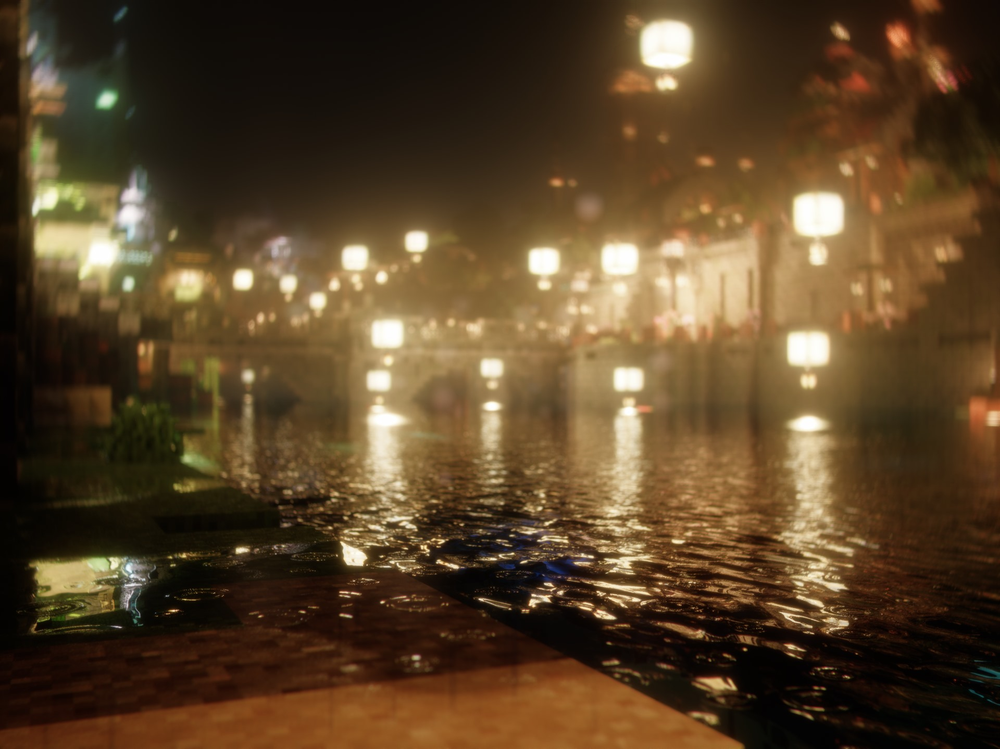
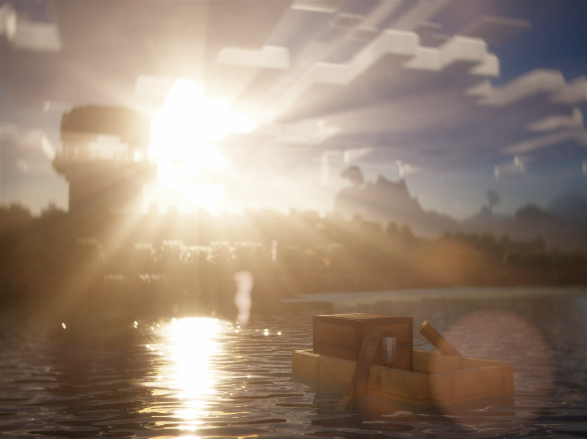
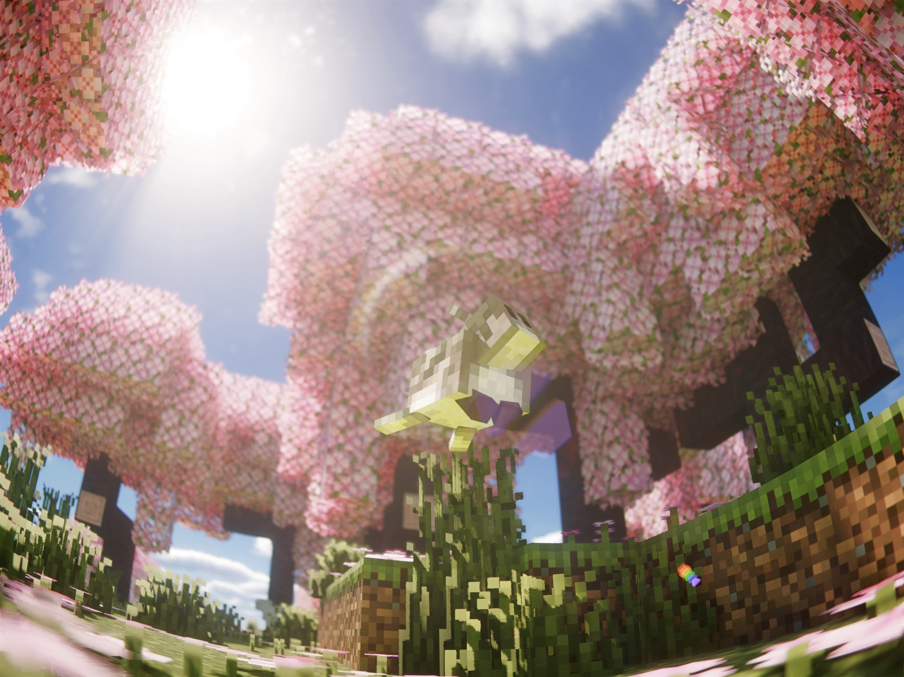
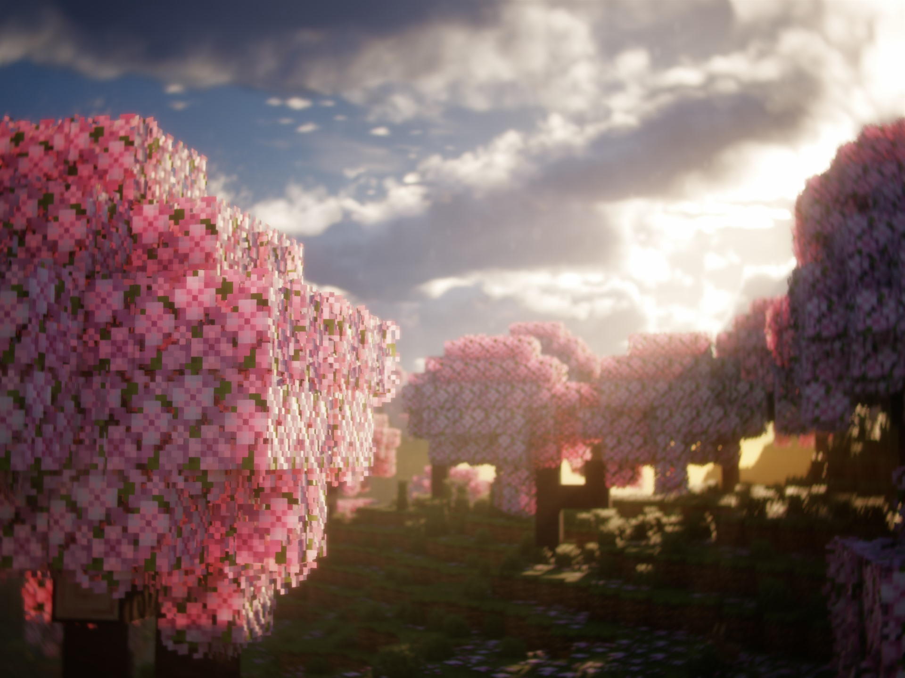

# Ray

English | [日本語](README.md)


Ray is a shader pack for Minecraft Java Edition with Iris. I originally built it privately for myself, packing in every feature I wanted that other shaders don't have  
It features light sources traced with voxel ray tracing, and a physical lens simulation that reproduces real lenses

It is better suited to shooting with replay and rendering mods than to everyday play, but with lighter settings it can also add presence to regular play  
The goal is to complete a cinematic look entirely inside the game, without going through external CG tools

The look is currently tuned toward a natural style

<p align="center">
  
  
  
  
</p>

## Features

The light of torches and lanterns is ray traced after turning the world around the camera into voxels, casting shadows that follow the shape of whatever blocks it  
Not only blocks but also players and mobs block light, so when you walk with a torch, your own shadow and the mobs' shadows fall on the walls  
Held light sources, dropped torches, burning mobs, and light arrows or fireballs are treated as light sources in the same way  
Voxel lighting is carried out properly all the way to the edge of the world

The water surface sparkles with reflections, and the scene below it is refracted  
Underwater light shafts shine in, and the glow around light sources turns turquoise in shallow water and deep blue in deep water

Instead of just adding bokeh and bloom, the post-processing runs a physical lens simulation that reproduces how real lenses render  
Presets range from old lenses such as the Helios 44-2 and Sonnar, to ultra-wide Hologon and Flektogon lenses, and fisheyes  
12 of the presets are calculated from the prescriptions of embodiments listed in patents  
Ghost color and shape, distortion, vignetting, bokeh shape, and chromatic aberration all change per lens  
It also has the same exposure modes as a real camera, plus manual exposure, so long exposures and panning shots are possible too

And with the analog filter, you can recreate an analog-noise look modeled on real equipment

> [!WARNING]
> This is still an alpha version
> Visuals and performance are still being tuned, and settings and defaults may change without notice

> [!NOTE]
> For the latest development news, check my posts on [Twitter/X](https://x.com/kuwamain)
> Pushes usually land about a day behind my local development build

## Requirements

| Item | Requirement |
|---|---|
| Minecraft | Java Edition 1.20.1 - 26.x |
| Shader loader | Iris 1.7 or later (with Sodium). See "Supported Versions" below for the versions |
| OpenGL | 4.6 (the shaders are GLSL 4.60 and use compute shaders / SSBOs / custom images) |
| OS | Developed and tested on Windows only. macOS does not work because compute shaders are not available there |
| GPU | The required performance has not been measured yet |

> [!IMPORTANT]
> Ray does not work with OptiFine. It relies on features that only Iris has, such as SSBOs, custom images, and compute shaders

> [!NOTE]
> Distant Horizons is not supported yet (the pack has no `dh_*` programs). If you keep DH installed, Iris treats Ray as a pack without DH shaders, but the look of the LOD area is not guaranteed

### Supported Versions

One zip supports the following loaders

| Loader | Minecraft | Status |
|---|---|---|
| Iris 1.7.x | 1.20.1 | Checked in the game with Iris 1.7.6 + Sodium 0.5.13 |
| Iris 1.8 - 1.10 | 1.21.x | Compile validation only |
| Iris 1.11.x | 26.1 | Checked in the game (26.1.2) |
| Oculus 1.8.0 (Forge) | 1.20.1 | Only compile and link have been checked. It has not been loaded in the game |

Older Iris versions (before 1.8) and Oculus differ from newer ones in firework sparks, entity shadows, detecting yourself, lightning, and how much the analog look has been checked (see "Requirements" in [troubleshooting.md](docs/guides/troubleshooting.md#動作環境), Japanese)

## Installation

Download `Ray-<version>-<commit>-nightly.zip` from the [nightly release](https://github.com/kuwacom/ray/releases/tag/nightly). The nightly is an alpha build of the latest `main`, and it is replaced whenever `shaders/` or similar files change

1. Download the zip (you do not need to extract it)
2. Put the zip into `<Minecraft instance>\shaderpacks\`
3. In the game, select Ray under Video Settings -> Shader Packs

When you report a bug, include the file name of the zip you installed

If you use a clone of the repository, put the folder that directly contains `shaders/` into `shaderpacks\`. To have your edits take effect right away, use "Linking with a Junction" under "Development" below

## Settings and Quick Reference

Settings are changed on the in-game settings screen  
At the top of the screen, first pick a quality preset (9 levels, default "High") and a look (10 options including Custom, default "Vivid")

The usage guides are written in Japanese only. Start from [docs/guides/README.md](docs/guides/README.md) (Japanese), which has one page per settings screen

| Page (Japanese) | Contents |
|---|---|
| [Presets and Looks](docs/guides/profiles.md) | Preset comparison, looks and LUTs, making your own LUT |
| [Block Light](docs/guides/block-light.md) | Torch and lantern light and shadows, handheld lights, how the light is computed |
| [Shadows and GI](docs/guides/shadows-gi.md) | Sun shadows, AO, GI |
| [Materials](docs/guides/materials.md) | labPBR, normals, POM, subsurface scattering |
| [Water and Reflections](docs/guides/water-reflections.md) | Waves, refraction, caustics, reflections |
| [Sky, Clouds, and Fog](docs/guides/sky-clouds-fog.md) | Atmosphere, cloud shapes, fog, volumetric light |
| [Camera](docs/guides/camera.md) | Exposure, depth of field, shutter, metering |
| [Lens](docs/guides/lens.md) | The 18 lenses, flare, distortion, fisheye |
| [Analog](docs/guides/analog.md) | The look of a 2000s CCD camcorder |
| [Post Processing](docs/guides/post-processing.md) | Tone map, color grading, bloom, TAA |
| [Performance](docs/guides/performance.md) | What to turn off when the frame rate is low |
| [Troubleshooting](docs/guides/troubleshooting.md) | Slow loading, stripes and noise, brightness, requirements |

The defaults and allowed values of every setting are listed in [docs/settings.md](docs/settings.md) (Japanese)

### Quality Presets

The presets are ordered from lightest to heaviest, and you can still change individual options after choosing one  
The relative cost is the ratio of frame times averaged over 4 scenes on an RTX 2080 Ti at 1297x803, with "High" as 1.0 (Low has not been measured). The differences between High, Ultra, and Extreme (Lite) are about the same as the measurement noise

| Preset | Relative cost | What it does |
|---|---|---|
| Low | - | Lit by floodfill light only. Light source shadows, GI, reflections, clouds, and volumetric light are turned off |
| Medium | 0.55 | Adds light source shadows (with partial block shapes and entity occlusion) and handheld light rays |
| High (Fastest) | 0.83 | The same techniques and look as High, with the lowest internal resolutions and sample counts |
| High (Fast) | 0.94 | A little closer to High than Fastest |
| High (default) | 1.00 | Contact shadows, RSM GI, 4 traced lights per pixel, depth of field, and so on |
| Ultra | 0.99 | High plus screen-space GI, more samples, ray traced water refraction, caustics, and POM |
| Extreme (Lite) | 1.02 | Voxel ray traced GI and voxel fill-in for reflections, with the same ranges as Ultra |
| Extreme (Balanced) | 1.57 | The Extreme ranges, with light tracing, GI, clouds, and volumetric light at half resolution |
| Extreme | 2.48 | Voxel ray traced GI with everything at full resolution. The heaviest |

The per-preset values of the main options are in the Japanese guide [Presets and Looks](docs/guides/profiles.md)  
If performance is too heavy, [Performance](docs/guides/performance.md) (Japanese) lists the settings that skip a whole pass when turned off, such as light source shadows, GI, volumetric clouds, reflections, volumetric light, TAA, motion blur, depth of field, and bloom

### Looks and LUTs

"Look" at the top of the settings screen picks how light and color are rendered all at once, separately from the quality preset  
"LUT" below it applies a color LUT at the very end, and "LUT Strength" mixes it with the original color

| Look | Appearance |
|---|---|
| Custom | Set the values that only presets have under "Post Processing" > "Color" > "Custom Look" (the defaults match Natural) |
| Natural | A plain look that keeps the simple Minecraft feel and is easy on the eyes |
| Vivid (default) | Beautiful just to look at, like SEUS Renewed / PTGI. Warm sunlit areas against blue-green shade, green bounce light from grass, highlights that stretch close to white. Bloom and contrast are restrained |
| Daylight | Vivid's lighting plus a deep blue sky, green grass, and shading on sunlit relief |
| Summer Sky | Bright, airy midsummer daytime with a deep blue sky down to the horizon |
| Golden Hour | Warmth like low late-afternoon sun all day long, with soft bloom |
| Teal & Orange | The film classic. Dark areas and grass toward teal, bright areas, wood, and soil toward orange |
| Bleach Bypass | A hard, desaturated image. The contrast is strong, so long sessions can tire your eyes |
| Cross Process | Yellow-green highlights and blue shadows. Strong color and contrast |
| Game (Vivid) | Clear colors and dark areas that are easier to see |

LUTs: None (default), User LUT, Sun and Shade Split, Film, Portra-like, Ektar-like, Vision3 500T-like, Velvia-like, Provia-like, Eterna-like  
The film-like LUTs are approximations made from the characteristics in the makers' public technical documents. No manufacturer LUTs or data are used  
To use your own LUT, replace `shaders/textures/look/user_lut.png` and set "LUT" to "User LUT". How to make one is in [Presets and Looks](docs/guides/profiles.md) (Japanese)

### Lenses

"Lens" on the settings screen lets you choose how a real lens renders. Each lens changes the color and shape of flare ghosts, the number of starburst rays, the bokeh shape, glow, corner darkening, and distortion  
Lenses 7 to 18 are calculated by ray tracing the prescriptions (radii of curvature, spacings, glass refractive indices and dispersion) of embodiments listed in patents. Recomputing the focal length from each prescription matches the nominal value to within about 1%

"Suggested FOV" is the real lens's angle of view when the 36mm width of a 35mm frame is fitted to the screen width, converted to Minecraft's (vertical) FOV. Lenses of 50mm and longer use 30, the game's minimum

| No. | Lens | Rendering character | Suggested FOV |
|---|---|---|---|
| 0 | Custom | Choose the ghost design from 15 constructions and set each effect individually | - |
| 1 | Modern fast prime (50mm F1.8 class) | Nearly fully corrected and subtle. Default | 30 |
| 2 | Helios 44-2 58mm F2 (1958) | Swirly bokeh and cat's eye bokeh, softness wide open | 30 |
| 3 | Super Takumar 50mm F1.4 (1965) | Strong glow and chromatic aberration wide open, a warm cast from thorium glass | 30 |
| 4 | Petzval 85mm F2.2 equivalent (1840 design) | Strong field curvature makes the edges swirl and melt, strong vignetting | 30 |
| 5 | Canon FD 50mm F1.4 S.S.C. (1973) | Little flare, a mild old lens with a slight glow wide open | 30 |
| 6 | Anamorphic | Blue horizontal streaks, vertically elongated oval bokeh, barrel distortion | Any |
| 7 | Zeiss Sonnar 50mm F1.5 (1932) | Few ghosts and high contrast, soft background bokeh | 30 |
| 8 | Leica Summilux 35mm F1.4 (1961) | The "Leica glow" wide open, dark corners, lemon-shaped bokeh near the edges | 32 |
| 9 | Canon 50mm F1.2 L39 (1956) | Soft and low contrast wide open, background smeared toward the edges | 30 |
| 10 | Zeiss Hologon 15mm F8 (ultra wide) | Straight lines stay straight across 110°, much darker corners, nearly everything in focus | 68 |
| 11 | Carl Zeiss Jena Flektogon 20mm F4 (ultra wide, 1963) | "Mustache" distortion, subtle at about 2% | 54 |
| 12 | Minolta Fish-eye Rokkor 16mm F2.8 (fisheye) | 180° diagonal, objects at the edges appear round, edges stay fairly bright | 110 |
| 13 | Nikon Gyogyotto 20mm F8 (fisheye, 1995) | 153° diagonal, close to orthographic projection, like looking into a glass ball | 107 |
| 14 | Voigtländer Ultra Wide-Heliar 12mm F5.6 (ultra wide) | 121° rectilinear, nearly straight lines, corners stay very dark even stopped down | 80 |
| 15 | Canon New FD 14mm F2.8L (ultra wide) | 114° diagonal, about 3% barrel distortion, very dark corners wide open | 72 |
| 16 | Minolta STF 135mm F2.8 [T4.5] (1999) | Apodization filter makes the edges of the bokeh melt away | 30 |
| 17 | Pentax FA 28mm F2.8 Soft (1997) | Wide-angle soft focus, a large glow wide open that is sharp by F5.6 | 40 |
| 18 | Canon 50mm F0.95 (1961) | The "Dream Lens", extremely dark corners and a glow wide open | 30 |

New lenses are added at the end, and existing numbers do not change, so that saved settings do not point to a different lens  
The details (fisheye framing, building the distortion inside TAA, aperture control for the soft-focus lenses) are in [Lens](docs/guides/lens.md) (Japanese)

## Development

| Path | Contents |
|---|---|
| [`shaders/`](shaders/) | The shader pack itself. The processing is in `lib/` and `program/`, and `world0` / `world-1` / `world1` are wrappers that only include them |
| [`docs/`](docs/) | Design documents and the usage guides ([`docs/README.md`](docs/README.md) (Japanese) is the index) |
| [`tools/`](tools/) | Python scripts for texture generation, compile validation, and in-game debugging ([`tools/README.md`](tools/README.md) (Japanese)) |
| [`CONTRIBUTING.en.md`](CONTRIBUTING.en.md) | Reporting bugs and how to validate (pull requests are not accepted during alpha and beta) |
| [`AGENTS.md`](AGENTS.md) (Japanese) | Working notes for coding agents (layout, validation commands, conventions) |

### Linking with a Junction

During development, instead of copying into `shaderpacks\`, link it to the repository with a junction so that edits take effect directly  
Press `R` in the game to reload the shaders

```powershell
New-Item -ItemType Junction -Path "<Minecraft instance>\shaderpacks\Ray" -Target "<path to this repository>"
```

With `cmd`, use `mklink /J "<instance>\shaderpacks\Ray" "<repository>"`  
Junctions can be created without administrator rights

Compile validation, the automated in-game debug loop with AI agents, and the processing flow are described in [CONTRIBUTING.en.md](CONTRIBUTING.en.md), [tools/README.md](tools/README.md) (Japanese), and [docs/architecture.md](docs/architecture.md) (Japanese)


## Roadmap

- [ ] Public release and distribution
  - [ ] Measure the GPU performance needed for each preset
  - [ ] Test on Linux
- [ ] Light source issues
  - [ ] Reduce flickering in places crowded with light sources (a light bin holds at most 64 lights, and lights outside the top picks are chosen by probability every frame. Add temporal reuse)
  - [ ] Add light source shadows to translucent surfaces (they are currently lit only by floodfill, so they are dark)
  - [ ] Register light from block entities such as ender chests as voxel light sources
  - [ ] Read the light level of light blocks (`minecraft:light`) correctly
  - [ ] Make stairs block light in their oriented shape (currently approximated as slabs)
  - [ ] Support glowing blocks from mods
- [ ] Optimization
  - [ ] Make light tracing lighter in scenes with many light sources
  - [ ] Make volumetric clouds and volumetric light lighter
  - [ ] Revisit the preset assignments based on measurements
- [ ] Camera and lenses
  - [ ] Add more lens presets
  - [ ] Implement wide-angle (high FOV) distortion
- [ ] Distant Horizons support

## Support

Your support for Ray's development is a big encouragement!

- [GitHub Sponsors](https://github.com/sponsors/kuwacom)
- [Ko-fi](https://ko-fi.com/kuwadev)

## Credits and License

No code from other shader packs is used  
The papers, techniques, and shader packs that informed the implementation are listed in [CREDITS.md](CREDITS.md) (in Japanese)

The license is the [LICENSE](LICENSE) (Ray Shader License 1.0). The key points are:

- Playing, streaming, videos, screenshots, and film work are free, whether or not you monetize them
- Including it in a modpack is free, even in a paid modpack, as long as the modpack has substantial content of its own and includes Ray unmodified, with credit and an official link (putting it directly in the zip is fine)
- To publish a modified fork, you must credit the original and differentiate it in visuals or features. A modified fork inherits this license (a plain copy with a new name is not allowed)
- Unmodified redistribution is free. Please include the author and a link to the official page
- Selling the pack or a modified fork, charging for it, or distributing it through ads is not allowed (except inclusion in a paid modpack)

The license text in [LICENSE](LICENSE) is authoritative. This summary is for convenience only

This license applies only to the version that contains this file
