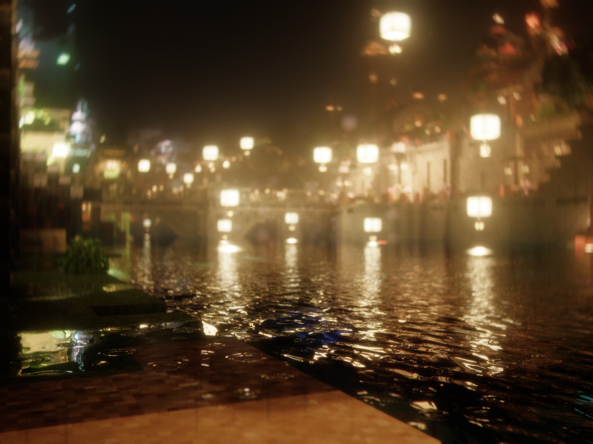
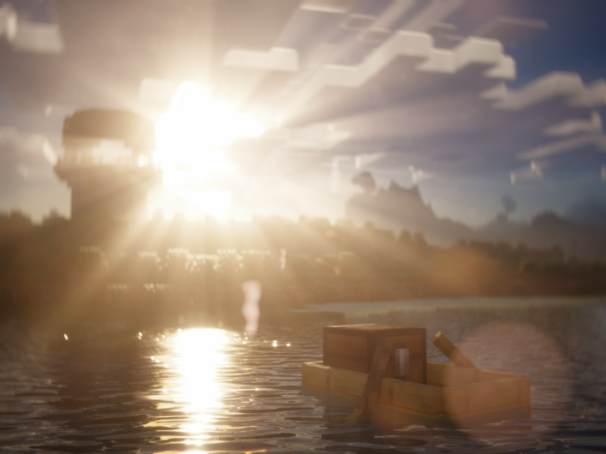
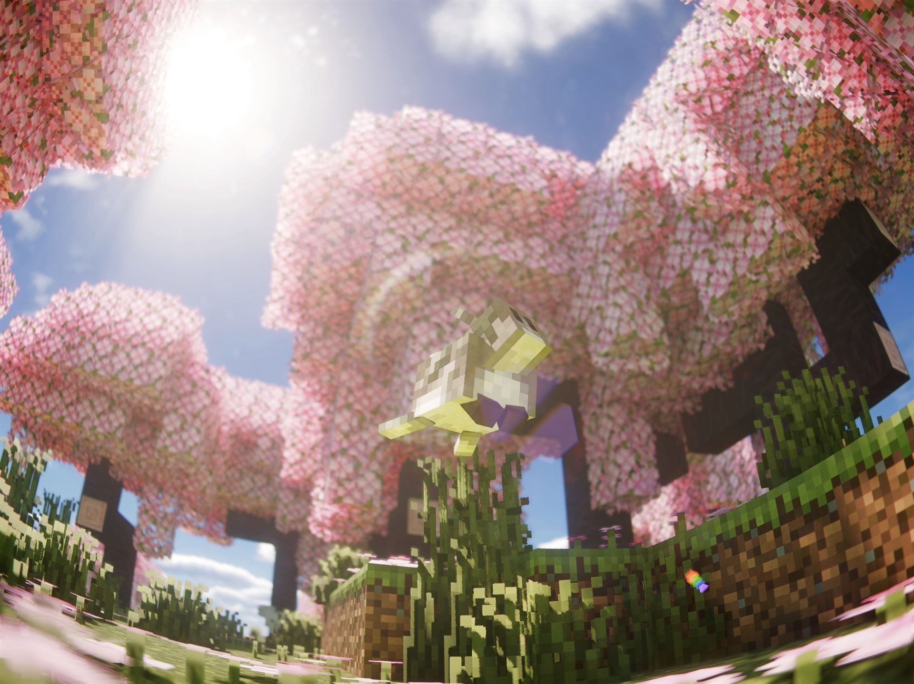
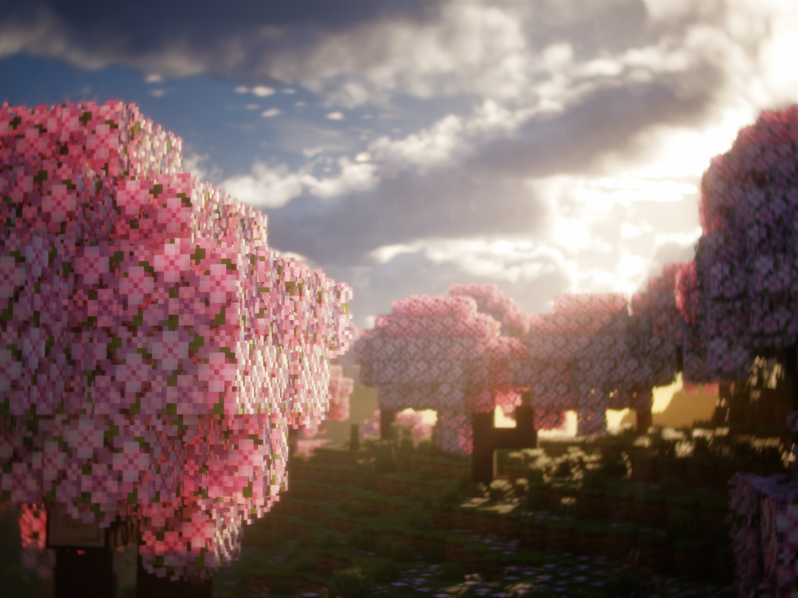
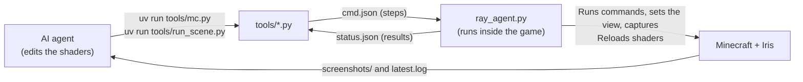

# Ray

English | [日本語](README.md)


Ray is a shader pack for Minecraft Java Edition with Iris. I originally built it privately for myself, packing in every feature I wanted that other shaders don't have  
It features light sources traced with voxel ray tracing, and a physical lens simulation that reproduces real lenses

It is better suited to shooting with replay and rendering mods than to everyday play, but with lighter settings it can also add presence to regular play  
The goal is to complete a cinematic look entirely inside the game, without going through external CG tools

The look is currently tuned toward a natural style

<p align="center">
  
  
  
  
</p>

## Features

The light of torches and lanterns is ray traced after turning the world around the camera into voxels, casting shadows that follow the shape of whatever blocks it  
Not only blocks but also players and mobs block light, so when you walk with a torch, your own shadow and the mobs' shadows fall on the walls  
Held light sources, dropped torches, burning mobs, and light arrows or fireballs are treated as light sources in the same way

The scene under the water surface is refracted and distorted  
Underwater light shafts shine in, and the glow around light sources turns turquoise in shallow water and deep blue in deep water

Instead of just adding bokeh and bloom, the post-processing runs a physical lens simulation that reproduces how real lenses render  
Presets range from old lenses such as the Helios 44-2 and Sonnar, to ultra-wide Hologon and Flektogon lenses, and fisheyes  
12 of the presets are calculated from the prescriptions of embodiments listed in patents  
Ghost color and shape, distortion, vignetting, bokeh shape, and chromatic aberration all change per lens

> [!WARNING]
> This is still an alpha version
> Visuals and performance are still being tuned, and settings and defaults may change without notice

## Requirements

| Item | Requirement |
|---|---|
| Minecraft | Java Edition 1.21.x - 26.x |
| Shader loader | Iris 1.8 or later (with Sodium) |
| OpenGL | 4.6 (the shaders are GLSL 4.60 and use compute shaders / SSBOs / custom images) |
| OS | Developed and tested on Windows only. macOS does not work because compute shaders are not available there |
| GPU | The required performance has not been measured yet |

> [!IMPORTANT]
> Ray does not work with OptiFine. It relies on features that only Iris has, such as SSBOs, custom images, and `shadow_entities`

> [!NOTE]
> Distant Horizons is not supported yet (the pack has no `dh_*` programs). If you keep DH installed, Iris treats Ray as a pack without DH shaders, but the look of the LOD area is not guaranteed

## Installation

The `shaders/` folder in the repository is the shader pack itself. There is no release zip yet, so install it with the following steps

1. Clone the repository, or download it as a ZIP and extract it
2. Put the folder that directly contains `shaders/` into `<Minecraft instance>\shaderpacks\`
3. In the game, select Ray under Video Settings -> Shader Packs

If you install it as a zip, make sure `shaders/` is at the top level of the zip

## Feature Details

### Light Sources and Shadows

| Feature | Description |
|---|---|
| Light source shadows | Converts the world around the camera into voxels, picks the light sources that contribute most for each pixel, and casts rays toward them with DDA. Slabs block light in their actual shape (stairs are approximated as slabs), and light that passes through stained glass takes on its color |
| Entity occlusion | Uses the triangles of player, mob, and block entity models as they are, so shadows follow the shape of the body. Transparent parts such as a skeleton's ribs let light through. Triangles beyond what fits, and everything on the "Low" setting, are approximated with 0.5-block voxels |
| Handheld lights | Each hand is treated as an independent light source. Shadows on walls come from voxel rays, and shadows from the hands, weapons, and nearby mobs come from screen-space rays. "Handheld Light Shadow Darkness" changes how dark the shadows are |
| Dropped items, projectiles, burning and glowing entities | Dropped torches, light arrows and fireballs, burning mobs, blazes, glow squid, and so on are registered as light sources and get shadows the same way as placed lights |
| Colored floodfill | Spreads the colors of light sources through the voxels as indirect light. When light source shadows are off, this alone provides the lighting. Light that bounces off walls picks up the average wall color (areas next to a red wall turn reddish). "Block Light Wall Bounce" changes the strength |

### Sky, Materials, and Camera

| Feature | Description |
|---|---|
| Atmosphere | Draws the sky with Hillaire (2020)-style LUTs. Sun and moon illuminance and sky ambient light are shared by all passes. The sun and moon can be the vanilla textures, round discs, or a realistic moon (drawn from NASA photos, for each phase) |
| Clouds | Clouds in 3 layers, whose type and amount are set by a weather map. Low clouds (cumulus, stratocumulus, nimbostratus, cumulonimbus) and mid clouds (altocumulus, altostratus) are volumetric, and high clouds (cirrus, cirrocumulus, cirrostratus) are drawn as flat layers. The cloud shape can be Ray / Bliss-like / Vanilla Shape / Realistic / Cotton Candy / Towering Cumulus / Sparse Fair-Weather / Stratocumulus Overcast. Lightweight 2D clouds and cloud shadows are also available |
| Fog | A flat-topped haze, a mid-height fog layer, and valley mist (changing with time of day, from day to day, and with weather and biome); aerial perspective that fades distant terrain into the horizon sky in the same direction; styles (Ray / Bliss-like / Nostalgia-like / Custom) and templates matched to the world height; volumetric light (including light shafts beyond the shadow distance); screen-space light shafts blurred radially from the sun or moon; fog lit by block light; and protection against light leaking into caves |
| Sun shadows | PCSS, colored shadows, screen-space contact shadows |
| GI / AO | RSM / SSGI / voxel ray traced GI (switched by preset), GTAO / SSAO |
| Materials | labPBR, normal maps, normals generated from textures, POM, subsurface scattering, rain puddles |
| Water and reflections | Waves and parallax, refraction (screen space / ray traced), caustics, SSR and rough reflections, voxel fill-in for reflections, underwater light shafts and the glow around light sources (turquoise in shallow water, deep blue in deep water) |
| Camera | 6 tone maps including AgX (default), histogram-based auto exposure (adapts at different speeds when getting brighter and when getting darker), MIP-Bokeh depth of field and autofocus, TAA, motion blur, bloom, lens flare, color grading (shadows / midtones / highlights, lift / gamma / gain, per-hue adjustments, tone curve, split toning, ASC CDL), a blue shift in the dark, film grain |

The techniques and sources for each feature are in [docs/architecture.md](docs/architecture.md) (in Japanese) and [CREDITS.md](CREDITS.md) (in Japanese)

## Look

"Look" at the top of the settings screen picks how light and color are rendered, all at once. "LUT" below it applies a color LUT at the very end

| No. | Look | Appearance |
|---|---|---|
| 0 | Custom | Set the values that only presets have in "Custom Look" under "Post Processing" (the defaults match Natural) |
| 1 | Natural (default) | A plain look that keeps the simple Minecraft feel and is easy on the eyes |
| 2 | Vivid | A look that is beautiful just to look at, like SEUS Renewed / PTGI. Instead of raising the overall saturation, it relies on the split between warm sunlit areas and blue-green shade; shade, birch trunks, and cave entrances tinted green by light bounced off the grass; and bright areas that stretch close to white. To stay easy on the eyes, shade is not as dark as in SEUS, and bloom and contrast are restrained |
| 3 | Daylight | Vivid's lighting plus a deep blue sky, green grass, and shading on sunlit relief, for a punchy clear-day look |
| 4 | Summer Sky | Bright, airy midsummer daytime, with a deep blue sky down near the horizon, lush greens, and warm sunlight |
| 5 | Golden Hour | Warmth like low late-afternoon sun all day long, with soft bloom |
| 6 | Teal & Orange | The film classic. Pushes the dark side and grass toward teal, and the bright side, wood, and soil toward orange |
| 7 | Bleach Bypass | A hard, desaturated image. The contrast is strong, so long sessions can tire your eyes |
| 8 | Cross Process | Bright areas shifted toward yellow-green and blue dark areas. Strong color and contrast |
| 9 | Game (Vivid) | A vivid look with clear colors and dark areas that are easier to see |

Presets 3 and above hold, in addition to the light values (table below), much of their color and tone as the baseline for color grading ("Color Grading" below). The values are in `shaders/lib/common/look_presets.glsl`

Natural and Vivid set the following values. The "multiplied" values are multiplied on top of the existing settings (Saturation, Contrast, Bloom, Bloomy Fog, Sky Light Occlusion, Sky Ambient Saturation, Fog Density). Exposure compensation is added. In Natural, only Highlight Range is 1.1; all other multiplied values are 1 and added values are 0, so each setting's value applies as it is

| Value | Natural | Vivid | Description |
|---|---|---|---|
| Sky Ambient Strength | 1 | 0.8 | Sky light that lights the shade. Does not change the brightness of the sky itself |
| Sky Ambient Saturation (multiplied) | 1 | 1.1 | The blueness of the sky light in the shade |
| Sky Color Saturation | 1 | 1.08 | How deep the blue of the sky is |
| Sunlight Warmth | 0 | 0.85 | Shifts only direct sunlight toward warm colors (at 1, the color of 5000K relative to 6500K) |
| Bounce Light Strength | 1 | 1.6 | Strengthens only the light from surfaces hit by GI rays (sky light is unchanged) |
| Bounce Light Saturation | 1 | 1.5 | Such as the green bounce light from grass. Does not change brightness |
| Sky Light Occlusion (multiplied) | 1 | 1.6 | SSGI / voxel ray tracing only. Multiplies the default 0.5 to give 0.8. Directionless blue sky light creeps less into caves and under eaves |
| Exposure (added) | 0 | -0.15 EV | |
| Highlight Range | 1.1 | 1.6 | Widens the brightness differences above middle gray (dark areas are unchanged) |
| Shadow Lift | 0 | 0.5 | On monitors that display with a 2.2 power curve, restores the tone-mapped shadows that get crushed to black |
| Contrast / Saturation (multiplied) | 1 / 1 | 1 / 1.1 | |
| Bloom Strength (multiplied) / Spread | 1 / 0.82 | 1.2 / 0.75 | A narrower spread gives a tighter glow around lights |
| Clear-Weather Bloomy Fog | 0.35 | 0.35 | The share of the wide glow over distant scenery on clear days (1 in rain) |
| Fog Density (multiplied) | 1 | 1.15 | Aerial perspective in the distance |

- The look is chosen separately from the quality presets (Low to Extreme), and it does not change when you change the quality preset
- Bounce light looks different depending on the GI method (RSM / SSGI / voxel ray tracing). RSM ("High") produces strongly colored bounce light, so Bounce Light Saturation is applied at only half strength

### LUT

| No. | LUT |
|---|---|
| 0 | None (default) |
| 1 | User LUT (`shaders/textures/look/user_lut.png`) |
| 2 | Sun and Shade Split: pushes sunlit areas warm and shade blue-green, bright greens toward yellow-green, and deepens the sky blue slightly |
| 3 | Film: slightly lowers contrast, and shifts bright areas warm while lowering their saturation |
| 4 | Portra-like: lower contrast, slightly lifted blacks, restrained warm colors, olive-leaning greens |
| 5 | Ektar-like: vivid reds and blues, firm contrast |
| 6 | Vision3 500T-like: a blue cast like tungsten cinema film used in daylight, soft gradation, blue-green shadows |
| 7 | Velvia-like: high saturation and contrast, deep blue skies and greens. Strong color and contrast |
| 8 | Provia-like: faithful and slightly vivid, with slightly cool, clean whites |
| 9 | Eterna-like: calm low saturation, soft contrast, shadows leaning blue-green |

The LUT is applied to the display colors (sRGB) after the tone map. "LUT Strength" mixes it with the original color

The film-like LUTs (4-9) are approximations made with `tools/gen_look_lut.py` from the characteristics (contrast, saturation, color tendencies, color temperature) described in the technical documents each manufacturer has published. No manufacturer LUTs or data are used

To use your own LUT, replace `shaders/textures/look/user_lut.png` and set "LUT" to "User LUT". The bundled `user_lut.png` is an identity LUT that changes nothing

- Make it in an image editor: open `user_lut.png` (1024x32), apply color adjustments (tone curve, hue, saturation, and so on; no blurs or transforms), and save it under the same name. The result matches applying the same adjustments to a screenshot of the game
- Make it from a `.cube` (a 3D LUT from DaVinci Resolve, Photoshop, and so on): `uv run tools/gen_look_lut.py from-cube my.cube --out shaders/textures/look/user_lut.png`. The input is expected to be a LUT on sRGB display values (0-1)
- Image format: a 1024x32 PNG that holds a 32x32x32 LUT as 32 tiles of 32x32 laid out horizontally, one per blue step. In each tile, x is red and y is green (the top row is green 0)
- Try a LUT on a screenshot: `uv run tools/gen_look_lut.py preview --lut my.cube --in shot.png --out out.png`

### Color Grading

"Color Grading" under "Post Processing" provides adjustments similar to the Color page in DaVinci Resolve. At their defaults none of them change anything, and they stack on top of the Look preset (saturation is multiplied; color and brightness shifts are added)

| Screen | Contents | Applied |
|---|---|---|
| Primary | White balance (color temperature), tint (green-magenta), contrast and pivot, saturation and vibrance, red / green / blue offsets (per-channel exposure), highlight compression, shadow lift | Before tone map |
| Shadows / Midtones / Highlights | Red, green, blue, luminance, saturation, and contrast for each brightness range. The range boundaries (EV from middle gray) and the softness of the boundaries | Before tone map |
| Per Hue | Hue, saturation, and brightness for red, orange, yellow, green, cyan, blue, purple, and magenta (colors in between are interpolated; no effect on low-saturation areas) | Before tone map |
| Lift / Gamma / Gain | Color wheels for red, green, blue, and luminance. Lift moves the blacks, gain the whites, and gamma the midtones | After tone map |
| Tone Curve | A monotonic curve through 7 points at 0, 10, 25, 50, 75, 90, and 100%. Applied to all of RGB or to luminance only | After tone map |
| Split Toning | Adds separate colors to the shadows and highlights (brightness does not change) | After tone map |
| CDL | ASC CDL (slope, offset, power, saturation). A final adjustment for entering values from other software as they are | After LUT |

The order is white balance -> tint -> offset -> contrast -> shadows / midtones / highlights -> highlight compression and shadow lift -> saturation and vibrance -> per hue -> tone map -> lift / gamma / gain -> tone curve -> split toning -> LUT -> CDL

- Adjustments before the tone map work in exposure stops (EV). They act the same way even when the brightness changes between day, night, and caves, and the tone map folds back anything out of range, so colors are less likely to clip
- Adjustments after the tone map apply to display values with black at 0 and white at 1. The film-like LUTs are applied after grading, so you can adjust the grade underneath the LUT's colors
- Turning off "Grading" removes both the adjustments on this screen and the Look preset's grading at once (white balance, contrast, saturation, LUT, and CDL remain)
- The rendering cost barely changes (it is computed only in the final pass and uses no extra textures)

## Lenses

"Lens" on the settings screen lets you choose how a real lens renders  
Each lens changes the color and shape of flare ghosts, the number of starburst rays, the bokeh shape, glow, corner darkening, and distortion. Choosing "Custom" lets you set the strength of each effect individually on the "Custom Lens" screen

For the 12 lenses from 7 to 18, the prescriptions of embodiments listed in patents (surface radii of curvature, spacings, and glass refractive indices and dispersion) are ray traced to compute ghost positions and colors, distortion, peripheral illumination, bokeh from field curvature and astigmatism, and chromatic aberration  
When the focal length is recomputed from each prescription, all of them match the nominal value to within about 1%. Coatings and aperture blades are not in the prescriptions, so they are based on product documentation and sample photos

"Suggested FOV" is the real lens's angle of view when the 36mm width of a 35mm frame is fitted to the screen width, converted to Minecraft's FOV (the vertical angle of view). The screen is 16:9, so the composition is a 35mm (3:2) frame with the top and bottom cut off. For a lens with focal length f (mm), vertical FOV = 2 atan(18 / f x 9 / 16), which gives 32 for 35mm, 54 for 20mm, and 68 for 15mm
50mm and longer would be narrower than the game's minimum FOV (30), so they use 30 (a slightly wider angle of view than the real lens)

| No. | Lens | Era | Construction | Rendering character | Suggested FOV |
|---|---|---|---|---|---|
| 0 | Custom | - | The construction (ghost design) can be chosen from the 15 below | Set the strength of each effect individually. You can also choose the 4th-order distortion term (mustache), the fisheye mapping, and apodization that melts the edges of the bokeh | - |
| 1 | Modern fast prime (50mm F1.8 class) | Modern | Multi-coated, 9 blades | Aberrations are almost fully corrected and subtle. Default | 30 (any) |
| 2 | Helios 44-2 58mm F2 | 1958 on (Helios-44 series) | Biotar type with 6 elements in 4 groups, single-coated, 8 blades | Swirly bokeh and cat's eye bokeh, softness wide open | 30 |
| 3 | Super Takumar 50mm F1.4 | 1965 | 7 elements in 6 groups, single-coated, 6 blades | Strong glow and chromatic aberration wide open, yellowing from thorium glass (a warm cast) | 30 |
| 4 | Petzval 85mm F2.2 equivalent | 1840 design | 4 elements in 2 groups, circular aperture | Strong field curvature makes the edges swirl and melt. Strong vignetting as well | 30 |
| 5 | Canon FD 50mm F1.4 S.S.C. | 1973 | 7 elements in 6 groups, multi-coated, 8 blades | An old lens with little flare and a mild character, with a slight glow wide open | 30 |
| 6 | Anamorphic | Cinema | The look of a 2x front anamorphic | Blue horizontal streaks, vertically elongated oval bokeh, barrel distortion | Any (no focal length is set) |
| 7 | Zeiss Sonnar 50mm F1.5 (Contax) | 1932 | 7 elements in 3 groups (cemented), postwar single coating and 11 blades | Only 6 glass-to-air surfaces, so few ghosts and high contrast. Pincushion distortion that pulls the corners slightly outward (3% at the corners). Soft background bokeh | 30 |
| 8 | Leica Summilux 35mm F1.4 (first version) | 1961 | 7 elements in 5 groups, single-coated, 10 blades | The "Leica glow", where light glows wide open. Almost no distortion. The corners are much darker, and out-of-focus highlights near the edges are lemon-shaped (cat's eye) | 32 |
| 9 | Canon 50mm F1.2 (L39) | 1956 | 7 elements in 5 groups, single-coated, 11 inward-curved blades | Soft and low contrast wide open. Astigmatism smears the background toward the edges, and the corners drop about -3.4 EV wide open. Many ghosts with the sun in frame, and fairly strong chromatic aberration | 30 |
| 10 | Zeiss Hologon 15mm F8 (ultra wide) | Around 1970 | 3 elements in 3 groups, fixed F8 with no blades | Straight lines stay straight even across a 110° diagonal (distortion is almost 0). Gets much darker toward the corners (about -2.5 EV at the corners). Nearly everything is in focus | 68 |
| 11 | Carl Zeiss Jena Flektogon 20mm F4 (ultra wide) | 1963 | Retrofocus with 10 elements in 6 groups, single-coated | "Mustache" distortion that is barrel-shaped in the middle of the frame and turns back to pincushion at the corners (subtle, about 2%). At the corners, outside the design's angle of view, the bokeh smears | 54 |
| 12 | Minolta Fish-eye Rokkor 16mm F2.8 (fisheye) | 1969 on | 10 elements in 7 groups + built-in filters, 180° diagonal | Straight lines that do not pass through the center bend strongly, and objects at the edges appear round instead of stretched. The edges do not get very dark | 110 |
| 13 | Nikon Gyogyotto 20mm F8 (fisheye) | 1995 | 3 elements in 2 groups, fixed F8 (no aperture blades), 153° diagonal | A fisheye close to orthographic projection that compresses things more strongly toward the edges, so the image looks round, as if looking into a glass ball. A larger center and stronger bending at the edges than the Rokkor. Nearly everything is in focus | 107 |
| 14 | Voigtländer Ultra Wide-Heliar 12mm F5.6 (ultra wide) | 2000 | 10 elements in 8 groups (1 aspherical), 121° diagonal | The widest rectilinear lens at the time of its release. Straight lines stay nearly straight (gentle barrel, 2% at the corners), while the corners stay very dark even when stopped down (about -3 EV) | 80 |
| 15 | Canon New FD 14mm F2.8L (ultra wide) | 1982 | 14 elements in 10 groups (1 ground aspherical), 6 blades, 114° diagonal | Barrel distortion that bulges in the middle of the frame and eases off at the corners (about 3%). The corners are very dark wide open (about -3 EV) and brighten when stopped down 2 stops | 72 |
| 16 | Minolta STF 135mm F2.8 [T4.5] | 1999 | 8 elements in 6 groups + apodization filter, 10-blade circular aperture | A filter that darkens toward its edge makes the edges of the bokeh melt away without leaving an outline. Almost no distortion or vignetting; only the bokeh shape changes | 30 |
| 17 | Pentax FA 28mm F2.8 Soft | 1997 | 5 elements in 5 groups, multi-coated, 6 blades | Wide-angle soft focus. Wide open, a large glow appears even on in-focus areas; it weakens at F4 and becomes sharp at F5.6. Softer toward the edges | 40 |
| 18 | Canon 50mm F0.95 | 1961 | Gauss type with 7 elements in 5 groups, 10 blades | The "Dream Lens". Extremely dark corners wide open (about -4 EV, -2 EV when stopped down 2 stops), and a glow wide open. Strong color fringing at the corners and barrel distortion | 30 |

- New lenses are added at the end, and existing numbers do not change (so that saved settings do not point to a different lens)
- Lenses of 50mm and longer have a wider angle of view than the real lens even at FOV 30, so at any FOV they apply as "the flavor of that lens's rendering". The aberration strength is set by matching the screen corners to the corners of a 35mm frame, so the shapes look the same when you change the FOV (only the fisheye projection is computed from angles, so it changes with the FOV)
- Ultra-wide and fisheye lenses come close to the real angle of view when used at the FOV in the table. The game renders with a rectilinear projection, so distortion and the fisheye projection are made by reprojecting the image in the final stage. Depth of field, bloom, and TAA are computed on the image before reprojection, and the sun flare is drawn on the image after reprojection, matched to the position of the light source
- The fisheye stretches the center by about 2x, so it is slightly softer. By default it fills the screen to the corners. Setting "Fisheye Framing" to "Fit Width" gives an angle of view closer to the real lens, but the corners outside the rendered area turn black. The real lens's 180° diagonal exceeds what the game can render (142° diagonal at FOV 110), so the fisheye FOV is set to the maximum of 110. With "Fit Width", the horizontal angle of view is then 137°, almost the same as the real lens (140°)
- With the fisheye and strong distortion settings, the distortion is built inside TAA ("Build Distortion In TAA", default Auto). The output image is built from frames that jitter shifts slightly every frame, so when the camera is still or moving slowly, even the stretched center of the fisheye shows fine detail. When moving fast or with TAA off, it looks the same as stretching in the final stage
- With "Fisheye Framing" set to "Fill Corners" (default), the Gyogyotto matches the real 20mm at FOV 107 (almost the same at 110), and unlike the Rokkor, it can render all four corners at the real focal length
- The STF 135mm apodization is made by multiplying each point of the depth-of-field bokeh by a transmittance that depends on its position on the aperture (brighter at the center, darker at the edge). The transmittance matches the product's T-stops (T4.5 wide open, T6.7 at F5.7), and stopping down cuts off the outer part of the aperture, so the bokeh approaches an ordinary round shape
- The softness of the FA 28mm Soft is built from the bloom's downsampled images, using the spread of an in-focus point computed from the prescription (the halo size and the fraction of light outside the core) for each f-number. It is strongest wide open and disappears at F5.6. To change the f-number, set the depth of field "Aperture Control" to "Custom f-number" (with "Bokeh Amount", it stays at the wide-open F2.8). The glow of the Canon 50/0.95 uses the same mechanism and applies only wide open
- Lenses with undercorrected spherical aberration (such as the FA 28 Soft) render background bokeh as a glowing disc with a bright center, and foreground bokeh as a ring with a bright rim (reversed between front and back)
- Raising "Distortion Strength" exaggerates distortion that is subtle in the prescription (such as the Flektogon's mustache). Turning "Distortion" OFF keeps the game's rectilinear projection, including for fisheyes

## Quality Presets

At the top of the settings screen, you can choose from 9 quality presets. They are ordered from lightest to heaviest, and the default is "High". You can still change individual options after choosing a preset

- High (Fastest) / High (Fast): The same techniques and look as High, with lower internal resolutions (light tracing and volumetric light, plus clouds in Fastest) and fewer samples (shadow blur, GI, light sources, reflections), made up for by temporal accumulation and denoising
- Extreme (Lite): Keeps the Extreme techniques (voxel ray traced GI, voxel fill-in for reflections, and so on), with ranges and resolutions matched to Ultra
- Extreme (Balanced): Keeps the Extreme ranges, with light tracing, GI, clouds, and volumetric light at half resolution
- Cloud shape and shading are the same on every preset from Medium up. Only the amount of fine noise and the cost change

| Item | Low | Medium | High (Fastest) | High (Fast) | High (default) | Ultra | Extreme (Lite) | Extreme (Balanced) | Extreme |
|---|---|---|---|---|---|---|---|---|---|
| Relative cost (High = 1.0) | - | 0.55 | 0.83 | 0.94 | 1.00 | 0.99 | 1.02 | 1.57 | 2.48 |
| Voxel range (blocks) | 128x64x128 | 192x96x192 | 256x128x256 | 256x128x256 | 256x128x256 | 256x128x256 | 256x128x256 | 384x128x384 | 384x128x384 |
| Light Source Shadows | OFF | ON | ON | ON | ON | ON | ON | ON | ON |
| Traced Lights per Pixel | - | 2 | 2 | 4 | 4 | 8 | 8 | 16 | 16 |
| Light trace resolution | - | 1/2 | 1/4 | 1/4 | 1/2 | Full | 1/2 | 1/2 | Full |
| Entity / player occlusion | OFF / OFF | OFF / ON | ON / ON | ON / ON | ON / ON | ON / ON | ON / ON | ON / ON | ON / ON |
| Handheld light rays and contact shadows | OFF | ON | ON | ON | ON | ON | ON | ON | ON |
| Entity lights (dropped items, etc.) | OFF | ON | ON | ON | ON | ON | ON | ON | ON |
| Sun shadows (resolution / distance) | 1024 / 96 | 2048 / 128 | 4096 / 192 | 4096 / 192 | 4096 / 192 | 4096 / 256 | 4096 / 256 | 8192 / 512 | 8192 / 512 |
| Shadow filter (samples) | PCF (4) | PCF (8) | PCSS (8) | PCSS (12) | PCSS (16) | PCSS (24) | PCSS (24) | PCSS (32) | PCSS (32) |
| AO | None | SSAO | GTAO | GTAO | GTAO | GTAO | GTAO | GTAO | GTAO |
| GI (resolution, samples) | None | None | RSM (1/2, 1) | RSM (1/2, 1) | RSM (1/2, 2) | SSGI (1/2, 4) | Voxel RT (1/2, 4) | Voxel RT (1/2, 4) | Voxel RT (Full, 8) |
| Reflections (SSR steps) | Sky only | SSR (12) | SSR + rough reflections (16) | SSR + rough reflections (24) | SSR + rough reflections (24) | SSR + rough reflections (32) | SSR + voxel fill-in (32) | SSR + voxel fill-in (48) | SSR + voxel fill-in (48) |
| Water refraction / caustics | None / OFF | SS / OFF | SS / OFF | SS / OFF | SS / OFF | Ray traced / ON | Ray traced / ON | Ray traced / ON | Ray traced / ON |
| POM | OFF | OFF | OFF | OFF | OFF | ON | ON | ON | ON |
| Atmosphere | Analytic approximation | Analytic approximation | LUT | LUT | LUT | LUT | LUT | LUT | LUT |
| Volumetric clouds (resolution / steps) | None | 1/4 / Low | 1/4 / Medium | 1/2 / Medium | 1/2 / Medium | 1/2 / High | 1/2 / High | 1/2 / Ultra | Full / Ultra |
| Volumetric light (resolution) | OFF | ON (1/4) | ON (1/4) | ON (1/4) | ON (1/2) | ON (colored, 1/2) | ON (colored, 1/2) | ON (colored, 1/2) | ON (colored, Full) |
| Depth of field (samples) | OFF | ON (30) | ON (30) | ON (30) | ON (30) | ON (50) | ON (50) | ON (75) | ON (75) |
| Motion blur | OFF | OFF | ON | ON | ON | ON | ON | ON | ON |
| Bloom / lens flare | OFF / ON | ON / ON | ON / ON | ON / ON | ON / ON | ON / ON | ON / ON | ON / ON | ON / ON |
| Auto exposure | Average | Average | Histogram | Histogram | Histogram | Histogram | Histogram | Histogram | Histogram |

Auto exposure adjusts outdoor nights to the moon phase and the weather. On clear nights lit by the moon, it lifts the exposure strongly to match the dark areas, while on new-moon nights, rainy nights, and underwater, it lifts less to keep the darkness. The "Auto (Average)" exposure does not use dark-area metering, and only the slope of the lift changes with the moon phase. It does not apply to manual exposure. "Night Lift" multiplies the amount of lift, and 0 gives dark nights with no lift

The relative cost is the ratio of frame times averaged over 4 scenes (clear noon outdoors, forest, torch-lit cave, waterside in the evening) on an RTX 2080 Ti at 1297x803, with "High" as 1.0. The differences between High, Ultra, and Extreme (Lite) are about the same as the measurement noise. "Low" has not been measured

<details>
<summary>Detailed setting values (per preset)</summary>

The main options and their values for each preset are listed in ["Settings and Presets" in docs/architecture.md](docs/architecture.md#設定とプリセット) (in Japanese)

The defaults are defined in [`shaders/lib/settings/`](shaders/lib/settings) (the same values as "High"), and the presets in `profile.*` in [`shaders/shaders.properties`](shaders/shaders.properties)

</details>

### Toggling Heavy Features

The heavy lighting features can be toggled individually, separately from the presets. They are all under "Block Lighting" on the settings screen

| Setting (display name) | Location | Description | Presets where it is OFF |
|---|---|---|---|
| Light Source Shadows | Light Source Shadows | Ray traced shadows for placed light sources. When OFF, lighting comes only from colored floodfill | Low |
| Traced Lights per Pixel / Trace Resolution | Light Source Shadows | The number of light sources that cast shadows, and the trace resolution (1 / 1/2 / 1/4) | - |
| Entity Occlusion | Light Source Shadows | Mobs and block entities block light | Low, Medium |
| Player Occlusion | Light Source Shadows | The player blocks light | Low |
| Light Contact Shadows | Light Source Shadows | Fills in details too small for the voxels in screen space | Low, Medium |
| Handheld Light Rays | Handheld Light | Voxel ray shadows for handheld lights | Low |
| Handheld Light Contact Shadows | Handheld Light | Screen-space shadows for handheld lights | Low |
| Entity Lights | Entity Lights | A switch that turns off the 4 below at once | Low |
| Dropped Item Lights / Projectile Lights / Burning Entity Lights / Glowing Entity Lights | Entity Lights | A switch for each type | - |

> [!TIP]
> Light source shadows, GI and AO (when both are OFF), volumetric clouds, the atmosphere LUT, reflections, volumetric light, TAA, motion blur, depth of field, and bloom skip their entire passes when turned OFF (`program.*.enabled` in `shaders.properties`). If performance is too heavy, try turning these off first

## Development

### Repository Layout

| Path | Contents |
|---|---|
| [`shaders/`](shaders/) | The shader pack itself. The processing is in `lib/` and `program/`, and `world0` / `world-1` / `world1` are wrappers that only include them |
| [`docs/`](docs/) | Design documents ([`docs/README.md`](docs/README.md) (in Japanese) is the index) |
| [`pyproject.toml`](pyproject.toml) | Definition of the Python environment for tools (uv) |
| [`AGENTS.md`](AGENTS.md) (in Japanese) | Working notes for coding agents (layout, validation commands, conventions) |
| [`tools/`](tools/) | Python scripts for texture generation, compile validation, and in-game debugging ([`tools/README.md`](tools/README.md) (in Japanese)) |

### Linking with a Junction

During development, instead of copying into `shaderpacks\`, link it to the repository with a junction so that edits take effect directly. Press `R` in the game to reload the shaders

```powershell
New-Item -ItemType Junction -Path "<Minecraft instance>\shaderpacks\Ray" -Target "<path to this repository>"
```

With `cmd`, use `mklink /J "<instance>\shaderpacks\Ray" "<repository>"`. Junctions can be created without administrator rights

### Compile Validation

You can check for compile errors without launching the game. The Python environment for the scripts is managed with [uv](https://docs.astral.sh/uv/), so first run `uv sync` at the repository root. How to get glslang and the available options are described in [tools/README.md](tools/README.md) (in Japanese)

```powershell
uv sync                                   # First time only. Installs Python 3.11, numpy, glfw, and PyOpenGL into .venv/
uv run tools/validate_shaders.py          # Reproduces the Iris preprocessor and compiles with glslang (defaults, Overworld)
uv run tools/validate_shaders.py --full   # Defaults in all 3 dimensions, all profiles in the Overworld
uv run tools/gl_compile_check.py          # compile + link with your local GPU driver
```

### Automated Debug Loop with AI Agents

With [Minescript](https://minescript.net/) (a client mod that runs Python scripts), you can run "change settings -> reload shaders -> capture fixed scenes -> check logs" from outside the game  
Every command is a CLI, so you can run a loop where a coding agent edits the shaders, looks at the captured screenshots and logs, and fixes them



```powershell
$env:RAY_MC_DIR = "<game directory>"
uv run tools/shader_options.py set GI_MODE=0 LIGHT_SHADOWS=false   # Change settings
uv run tools/run_scene.py --all --reload --tag v2                  # Reload and capture all scenes -> <game>/screenshots/v2_<scene>.png
```

The game-side setup (installing Minescript, keeping `ray_agent.py` running, and creating the fixed scenes in `scenes.json`) is described in [tools/README.md](tools/README.md#ゲーム内で撮影する) (in Japanese)

### Common Pitfalls

> [!WARNING]
> - Do not write non-ASCII characters in `*.properties`. Iris reads these files as ISO-8859-1, so Japanese text, even in a comment, causes the whole file to be ignored (`validate_shaders.py` checks for this)
> - NVIDIA drivers allow at most 8 image uniforms per stage. The declarations in `lib/buffers/images.glsl` are opt-in, so in programs that write to images, `#define` only the `IMG_*` you use before declaring `common.glsl`

## Pipeline

The processing flow, following the Iris execution order. The inputs, outputs, and buffer assignments of each pass are in ["Render Pipeline" in docs/architecture.md](docs/architecture.md#レンダーパイプライン) (in Japanese)

```mermaid
flowchart TD
    setup["setup<br/>Build the light table in an SSBO<br/>Atmosphere LUTs (transmittance, multiple scattering)"]
    begin["begin<br/>Clear the light list"]
    shadow["shadow<br/>Sun shadow map<br/>Voxelize terrain and entities<br/>Register off-screen entity lights"]
    prepare["prepare<br/>Sun and moon illuminance, sky SH<br/>SkyView LUT / cloud weather map and cloud shadows"]
    gbuf["gbuffers (opaque)<br/>G-buffer<br/>Register on-screen entity lights"]
    subgraph deferred["deferred"]
        direction TB
        flood["One floodfill step<br/>Sort light sources into light bins"]
        trace["Light source shadows<br/>Trace the N selected lights with DDA<br/>Spatiotemporal denoising"]
        gi["GI / AO"]
        cloud["Volumetric clouds"]
        shade["Opaque shading + sky"]
        flood --> trace --> gi --> cloud --> shade
    end
    translucent["gbuffers (translucent)<br/>Forward shading of water and glass"]
    subgraph composite["composite"]
        direction TB
        refl["Reflections and translucent compositing"]
        fog["Volumetric light / fog"]
        post["TAA / motion blur / DoF / bloom / auto exposure"]
        refl --> fog --> post
    end
    final["final<br/>AgX tone map, color adjustment, CAS"]

    setup --> begin --> shadow --> prepare --> gbuf --> deferred --> translucent --> composite --> final
```



<details>
<summary>Block light flow (how light source shadows work)</summary>

1. Voxelization: the shadow pass writes the terrain into voxels (1 block = 1 cell). Entities write their model triangles to an SSBO (anything that does not fit becomes 0.5-block occupancy bits), and glowing entities (dropped items, burning mobs, and so on) are registered as light sources
2. Floodfill: spreads light colors to the 6 neighbors, one step per frame, as the basis for indirect light
3. Light sorting: sorts all light sources into light bins of 8x8x8 blocks
4. Tracing: for each pixel, the lights in its bin are weighted by brightness. The top N-1 are always traced, and one of the rest is picked with a probability proportional to its brightness and traced, so on average even the lights that were not picked get correct shadows. Penumbrae are made by jittering over the size of the light source over time
5. Denoising: reprojection, neighborhood clamping, and an edge-preserving spatial filter smooth out the noise
6. Compositing: direct light, floodfill (indirect light), handheld lights, and specular reflections are combined for the final lighting

Handheld lights are not added to the floodfill, so that they are not counted twice, and are computed directly per pixel instead

</details>

## Roadmap

- [ ] Public release and distribution
  - [ ] Measure the GPU performance needed for each preset
  - [ ] Test on Linux
- [ ] Light source issues
  - [ ] Reduce flickering in places crowded with light sources (a light bin holds at most 64 lights, and lights outside the top picks are chosen by probability every frame. Add temporal reuse)
  - [ ] Add light source shadows to translucent surfaces (they are currently lit only by floodfill, so they are dark)
  - [ ] Register light from block entities such as ender chests as voxel light sources
  - [ ] Read the light level of light blocks (`minecraft:light`) correctly
  - [ ] Make stairs block light in their oriented shape (currently approximated as slabs)
  - [ ] Support glowing blocks from mods
- [ ] Optimization
  - [ ] Make light tracing lighter in scenes with many light sources
  - [ ] Make volumetric clouds and volumetric light lighter
  - [ ] Revisit the preset assignments based on measurements
- [ ] Camera and lenses
  - [ ] Add more lens presets
  - [ ] Implement wide-angle (high FOV) distortion
- [ ] Distant Horizons support

## Support

Your support for Ray's development is a big encouragement!

- [GitHub Sponsors](https://github.com/sponsors/kuwacom)
- [Ko-fi](https://ko-fi.com/kuwadev)

## Credits and License

No code from other shader packs is used  
The papers, techniques, and shader packs that informed the implementation are listed in [CREDITS.md](CREDITS.md) (in Japanese)

The license is the [LICENSE](LICENSE) (Ray Shader License 1.0). The key points are:

- Playing, streaming, videos, screenshots, and film work are free, whether or not you monetize them
- Including it in a modpack is free, even in a paid modpack, as long as the modpack has substantial content of its own and includes Ray unmodified, with credit and an official link (putting it directly in the zip is fine)
- To publish a modified fork, you must credit the original and differentiate it in visuals or features. A modified fork inherits this license (a plain copy with a new name is not allowed)
- Unmodified redistribution is free. Please include the author and a link to the official page
- Selling the pack or a modified fork, charging for it, or distributing it through ads is not allowed (except inclusion in a paid modpack)

The license text in [LICENSE](LICENSE) is authoritative. This summary is for convenience only

This license applies only to the version that contains this file
