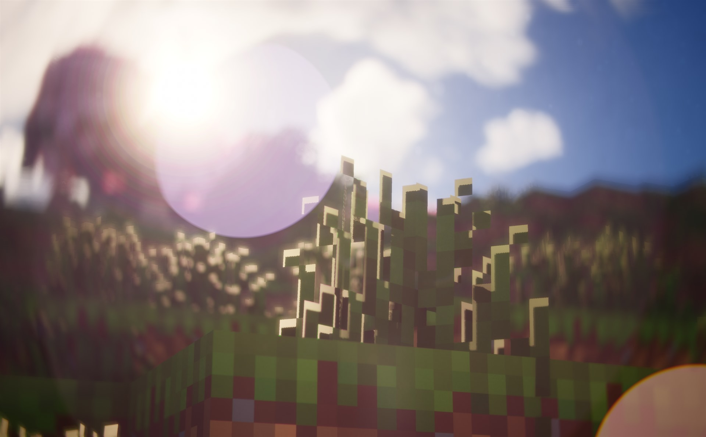
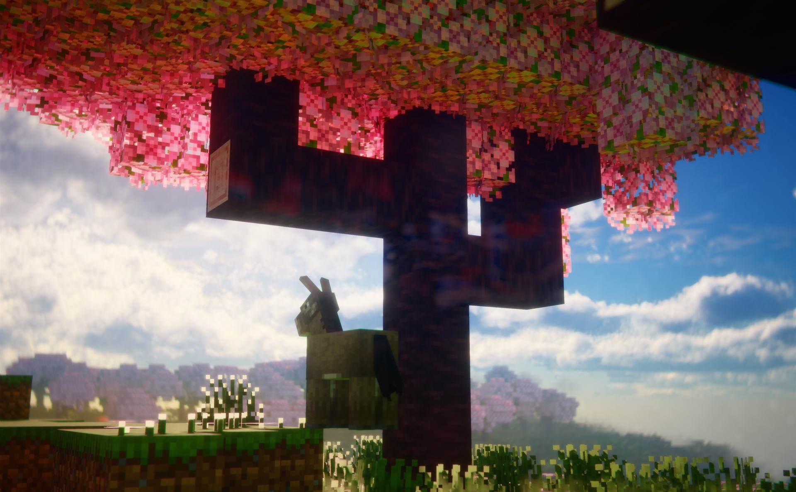
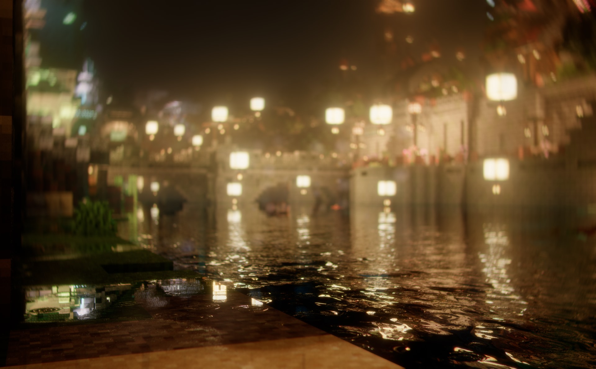

# Ray

> [!IMPORTANT]
> 来週公開予定です  
> このリポジトリは一般公開に向けて準備中で、シェーダーパックの配布は公開に合わせて始めます  
> ソースコードとドキュメントは、公開時にこのリポジトリへ追加します

Rayは元々私が欲しかった他のシェーダーにない機能を全て詰め込んだプライベートに作られた Minecraft Java Edition - Iris 向けのシェーダーパックです  
このシェーダーには、ボクセルレイトレースによる光源処理と実在レンズを再現するフィジカルレンズシミュレーションを搭載しています

  
  
  
  

日常利用よりも、リプレイMODやレンダリングMODを併用した撮影に向いていますが、設定を軽くすれば、普段のプレイで臨場感を高めることもできます  
このシェーダーは、外部のCGツールを挟まずシネマティックルックをゲーム内だけで完結させるのが目的です

現在はナチュラル寄りの見た目で制作しています

## 特徴

たいまつやランタンの光は、カメラ周辺のワールドをボクセルに変えてレイトレースし、遮るものの形どおりの影を落とします  
ブロックだけでなくプレイヤーやモブも光を遮るので、たいまつを持って歩くと自分やモブの影が壁に落ちます  
手に持った光源、地面に落としたたいまつ、燃えているモブ、光の矢や火の玉も同じように光源として扱います

水面の下の景色は屈折してゆがんで見えます  
水中の光芒が差し込み、光源のまわりのにじみは浅瀬でターコイズ、深い所で紺になります

ボケやブルームを足すだけではなく、ポストプロセスでフィジカルレンズシミュレーションを行い、実在するレンズの写りを再現します  
Helios 44-2 や Sonnar のようなオールドレンズから、Hologon や Flektogon の超広角、魚眼までプリセットで選べます  
プリセットのうち 12 本は、特許に載った実施例の処方から計算しています  
ゴーストの色と形、歪曲、周辺減光、ボケの形、色収差はレンズごとに変わります

> [!WARNING]
> 現在はまだアルファ版です
> 見た目と負荷はまだ調整中で、設定項目や既定値は予告なく変わる可能性があります

## 支援

Ray の開発を支援していただけると大変励みになります！

- [GitHub Sponsors](https://github.com/sponsors/kuwacom)
- [Ko-fi](https://ko-fi.com/kuwadev)

## クレジットとライセンス

他のシェーダーパックのコードは使っていません  
実装の参考にした論文・手法とシェーダーパックは [CREDITS.md](CREDITS.md) に載せています

ライセンスは [LICENSE](LICENSE) (Ray Shader License 1.0) です。要点は次のとおりです

- プレイ・配信・動画・スクショ・映像作品は、収益化の有無を問わず自由です
- modpack への同梱は、有料の modpack でも、modpack 自体に実質的な中身があり、内容を変えずクレジットと公式リンクを添えてなら自由です(直接 zip に入れても構いません)
- 改変版フォークを公開する場合は、フォーク元明記と、見た目または機能の差別化が必要です。改変版もこのライセンスを継承します(ただの丸コピのリネームはダメ)
- 無改変の再配布は自由です。作者と公式へのリンクを添えてください
- 本体及び改変版フォークの販売や課金、広告を通した配布はできません(有料 modpack への同梱は除く)

このライセンスは、このファイルを含む版にのみ適用されます
