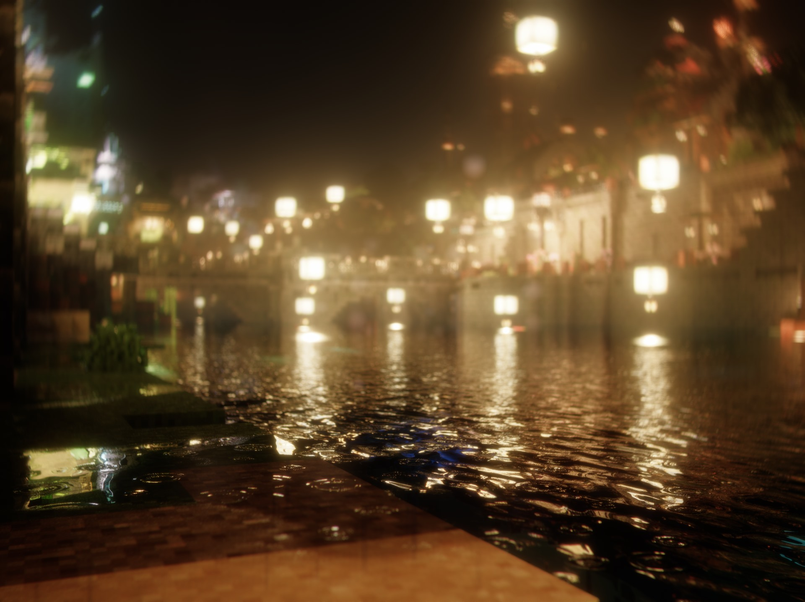
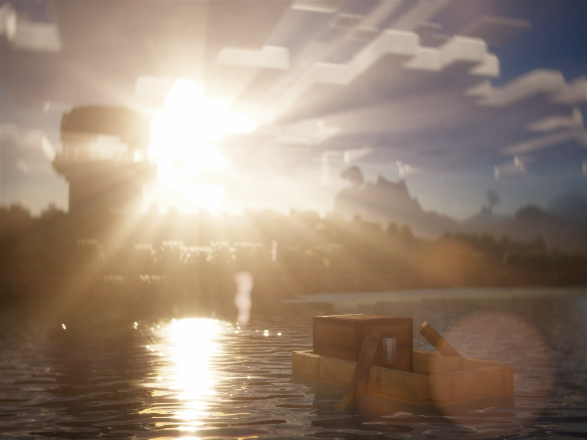
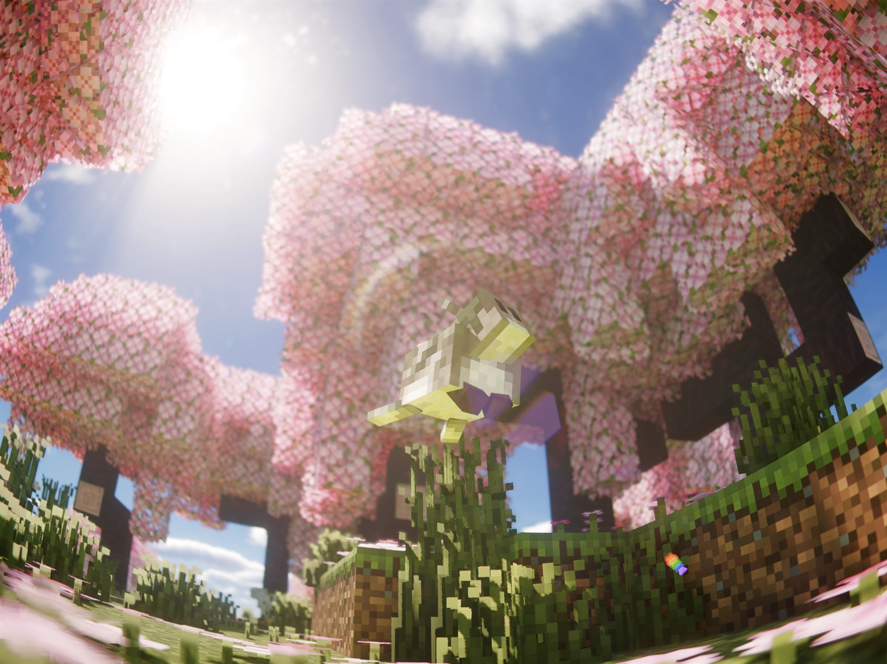
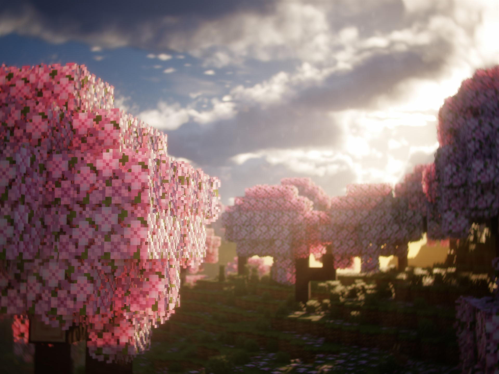

# Ray

[English](README.en.md) | 日本語


Rayは元々私が欲しかった他のシェーダーにない機能を全て詰め込んだプライベートに作られた Minecraft Java Edition - Iris 向けのシェーダーパックです  
このシェーダーには、ボクセルレイトレースによる光源処理と実在レンズを再現するフィジカルレンズシミュレーションを搭載しています

日常利用よりも、リプレイMODやレンダリングMODを併用した撮影に向いていますが、設定を軽くすれば、普段のプレイで臨場感を高めることもできます  
このシェーダーは、外部のCGツールを挟まずシネマティックルックをゲーム内だけで完結させるのが目的です

現在はナチュラル寄りの見た目で制作しています

<p align="center">
  
  
  
  
</p>

## 特徴

たいまつやランタンの光は、カメラ周辺のワールドをボクセルに変えてレイトレースし、遮るものの形どおりの影を落とします  
ブロックだけでなくプレイヤーやモブも光を遮るので、たいまつを持って歩くと自分やモブの影が壁に落ちます  
手に持った光源、地面に落としたたいまつ、燃えているモブ、光の矢や火の玉も同じように光源として扱います  
ワールドの端までしっかりとボクセル光源処理を行います

水面はキラキラと反射し、下の景色は屈折します  
水中の光芒が差し込み、光源のまわりのにじみは浅瀬でターコイズ、深い所で紺になります

ボケやブルームを足すだけではなく、ポストプロセスでフィジカルレンズシミュレーションを行い、実在するレンズの写りを再現します  
Helios 44-2 や Sonnar のようなオールドレンズから、Hologon や Flektogon の超広角、魚眼までプリセットで選べます  
プリセットのうち 12 本は、特許に載った実施例の処方から計算しています  
ゴーストの色と形、歪曲、周辺減光、ボケの形、色収差はレンズごとに変わります  
実際のカメラと同じ露出モードやマニュアル露出を搭載しているので、長時間露光や流し撮り等も可能です

また、アナログフィルターを利用すれば、実際の機材を再現したアナログノイズルックを再現できます

> [!WARNING]
> 現在はまだアルファ版です
> 見た目と負荷はまだ調整中で、設定項目や既定値は予告なく変わる可能性があります

> [!NOTE]
> 開発の最新情報については [Twitter/X](https://x.com/kuwamain) での投稿をご確認ください
> ローカルでの開発版とのpushの時間差は概ね1日程度です

## 動作環境

| 項目 | 要件 |
|---|---|
| Minecraft | Java Edition 1.20.1 - 26.x |
| シェーダーローダー | Iris 1.7 以降 (Sodium と併用) |
| OpenGL | 4.6 (シェーダーは GLSL 4.60 で、compute shader / SSBO / カスタムイメージを使います) |
| OS | 開発と動作確認は Windows のみです。macOS は compute shader が使えないため動きません |
| GPU | 必要な性能はまだ測れていません |

> [!IMPORTANT]
> OptiFine では動きません。SSBO・カスタムイメージ・compute shader など Iris にしかない機能を前提にしています

> [!NOTE]
> 現状はまだ Distant Horizons には対応していません (`dh_*` プログラムを持っていません)。入れたままでも Iris は DH 用のシェーダーがないパックとして扱いますが、LOD 部分の見た目は保証できません

### 対応バージョン

| ローダー | Minecraft | 状態 |
|---|---|---|
| Iris 1.7.x | 1.20.1 | Iris 1.7.6 + Sodium 0.5.13 で実機で確認しています |
| Iris 1.8 - 1.10 | 1.21.x | コンパイルの検証だけです |
| Iris 1.11.x | 26.1 | 実機で確認しています (26.1.2) |
| Oculus 1.8.0 (Forge) | 1.20.1 | コンパイルとリンクの確認だけで、実機では読み込んでいません |

古い Iris (1.8 未満) と Oculus では、花火の火花・エンティティの影・自分の判定・雷・アナログの確認状況が新しい Iris と違います ([docs/guides/troubleshooting.md の「動作環境」](docs/guides/troubleshooting.md#動作環境))

## 導入

[Releases の nightly](https://github.com/kuwacom/ray/releases/tag/nightly) から `Ray-<バージョン>-<コミット>-nightly.zip` をダウンロードして入れます。nightly は `main` の最新を反映したアルファ版で、`shaders/` などが変わるたびに置き換わります

1. zip をダウンロードします (展開は不要です)
2. zip を `<Minecraft のインスタンス>\shaderpacks\` に置きます
3. ゲーム内の ビデオ設定 -> シェーダーパック で Ray を選びます

不具合を報告するときは、入れた zip のファイル名を書いてください

リポジトリを clone して使う場合は、`shaders/` を直接含むフォルダを `shaderpacks\` に置きます。編集をそのまま反映したいときは、下の「開発」の「ジャンクションでつなぐ」を使います

## 設定と使い方

設定はゲーム内の設定画面から変えます  
まず設定画面のいちばん上で、品質プロファイル (9 段、既定は「高」) とルック (9 種、既定は「ビビッド」) を選びます

使い方は [docs/guides/README.md](docs/guides/README.md) から入れます  
画面ごとに次のページがあります

| ページ | 内容 |
|---|---|
| [プロファイルとルック](docs/guides/profiles.md) | プロファイルごとの違いの早見表、ルックと LUT の一覧、自分の LUT の作り方 |
| [ブロックライト](docs/guides/block-light.md) | たいまつやランタンの光と影、手持ち光源、光の計算の流れ |
| [影と GI](docs/guides/shadows-gi.md) | 太陽の影、AO、GI |
| [マテリアル](docs/guides/materials.md) | labPBR、法線、POM、表面下散乱 |
| [水と反射](docs/guides/water-reflections.md) | 波、屈折、コースティクス、反射 |
| [空・雲・フォグ](docs/guides/sky-clouds-fog.md) | 大気、雲の形、フォグ、ボリューメトリックライト |
| [カメラ](docs/guides/camera.md) | 露出、ボケ、シャッター、測光 |
| [レンズ](docs/guides/lens.md) | レンズ 18 種の一覧、フレア、歪曲、魚眼 |
| [アナログ](docs/guides/analog.md) | 2000 年代の CCD ビデオカメラの画 |
| [ポストプロセス](docs/guides/post-processing.md) | トーンマップ、カラーグレーディング、ブルーム、TAA |
| [重い設定と軽くする順番](docs/guides/performance.md) | フレームが足りないとき |
| [困ったとき](docs/guides/troubleshooting.md) | 読み込みが遅い、縞やノイズ、暗さ、動作環境 |

全設定の既定値と値の候補は [docs/settings.md](docs/settings.md) にあります

## 開発

| パス | 内容 |
|---|---|
| [`shaders/`](shaders/) | シェーダーパック本体。処理は `lib/` と `program/` にあり、`world0` / `world-1` / `world1` は include だけのラッパーです |
| [`docs/`](docs/) | 設計資料と使い方のガイド ([`docs/README.md`](docs/README.md) が目次) |
| [`tools/`](tools/) | テクスチャ生成、コンパイル検証、ゲーム内デバッグ用の Python スクリプト ([`tools/README.md`](tools/README.md)) |
| [`CONTRIBUTING.md`](CONTRIBUTING.md) | 不具合の報告、検証の手順 (alpha・beta の間は Pull Request を受け付けていません) |
| [`AGENTS.md`](AGENTS.md) | コーディングエージェント向けの作業メモ (構成・検証コマンド・規約) |

### ジャンクションでつなぐ

開発中は `shaderpacks\` にコピーせず、ジャンクションでリポジトリにつなぐと編集がそのまま反映されます  
ゲーム内で `R` キーを押すとシェーダーが再読み込みされます

```powershell
New-Item -ItemType Junction -Path "<Minecraft のインスタンス>\shaderpacks\Ray" -Target "<このリポジトリのパス>"
```

`cmd` なら `mklink /J "<インスタンス>\shaderpacks\Ray" "<リポジトリ>"` です  
ジャンクションは管理者権限なしで作れます

コンパイルの検証、AI エージェントによるゲーム内の自動デバッグ、処理の流れは、[CONTRIBUTING.md](CONTRIBUTING.md)、[tools/README.md](tools/README.md)、[docs/architecture.md](docs/architecture.md) にあります

## ロードマップ

- [ ] 公開・配布
  - [ ] プリセットごとに必要な GPU 性能を測る
  - [ ] Linux での動作確認
- [ ] 光源の問題
  - [ ] 光源が密集した場所のちらつきを抑える (ライトビン 1 つに 64 個までしか入らず、上位から漏れた光源は毎フレーム確率で選んでいるため。時間方向の再利用を入れる)
  - [ ] 半透明の面にも光源の影を付ける (いまは floodfill だけで照らすので暗め)
  - [ ] エンダーチェストなどブロックエンティティの光をボクセルの光源に登録する
  - [ ] ライトブロック (`minecraft:light`) の光レベルを正しく読む
  - [ ] 階段を向きどおりの形で遮る (いまはハーフブロックとして近似)
  - [ ] MOD の光るブロックに対応する
- [ ] 最適化
  - [ ] 光源の多い場面での光源トレースを軽くする
  - [ ] 体積雲とボリューメトリックライトを軽くする
  - [ ] 計測した結果からプリセットの割り当てを見直す
- [ ] カメラ・レンズ
  - [ ] レンズのプリセットを増やす
  - [ ] 広角 (高い FOV) ゆがみ実装
- [ ] Distant Horizons 対応

## 支援

Ray の開発を支援していただけると大変励みになります！

- [GitHub Sponsors](https://github.com/sponsors/kuwacom)
- [Ko-fi](https://ko-fi.com/kuwadev)

## クレジットとライセンス

他のシェーダーパックのコードは使っていません  
実装の参考にした論文・手法とシェーダーパックは [CREDITS.md](CREDITS.md) に載せています  
各機能の手法は [docs/architecture.md](docs/architecture.md) にあります

ライセンスは [LICENSE](LICENSE) (Ray Shader License 1.0) です。要点は次のとおりです

- プレイ・配信・動画・スクショ・映像作品は、収益化の有無を問わず自由です
- modpack への同梱は、有料の modpack でも、modpack 自体に実質的な中身があり、内容を変えずクレジットと公式リンクを添えてなら自由です(直接 zip に入れても構いません)
- 改変版フォークを公開する場合は、フォーク元明記と、見た目または機能の差別化が必要です。改変版もこのライセンスを継承します(ただの丸コピのリネームはダメ)
- 無改変の再配布は自由です。作者と公式へのリンクを添えてください
- 本体及び改変版フォークの販売や課金、広告を通した配布はできません(有料 modpack への同梱は除く)

このライセンスは、このファイルを含む版にのみ適用されます
