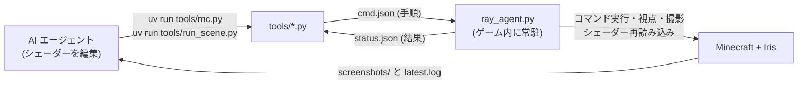
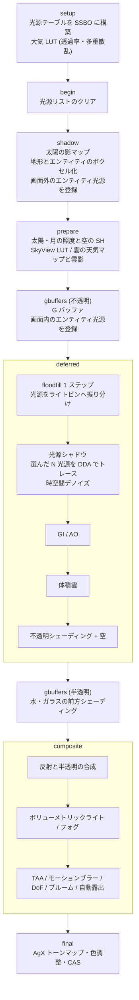

# Ray


Minecraft Java Edition 用の Iris シェーダーパックです

たいまつやランタンの光をボクセル上のレイトレースですべてに影響して影付けします  
ブロックだけでなくプレイヤーやモブも光を遮るので、たいまつを持って歩くと自分やモブの影が壁に落ちます  
手に持った光源、地面に落としたたいまつ、燃えているモブ、光の矢なども同じように影を作ります

> [!WARNING]
> アルファ版です。見た目と負荷はまだ調整中で、設定項目や既定値は予告なく変わります

<!-- スクショ予定 -->

## 動作環境

| 項目 | 要件 |
|---|---|
| Minecraft | Java Edition 1.21.x - 26.x |
| シェーダーローダー | Iris 1.8 以降 (Sodium と併用) |
| OpenGL | 4.6 (シェーダーは GLSL 4.60 で、compute shader / SSBO / カスタムイメージを使います) |
| OS | 開発と動作確認は Windows のみです。macOS は compute shader が使えないため動きません |
| GPU | 必要な性能はまだ測れていません |

> [!IMPORTANT]
> OptiFine では動きません。SSBO・カスタムイメージ・`shadow_entities` など Iris にしかない機能を前提にしています

> [!NOTE]
> 現状はまだ Distant Horizons には対応していません (`dh_*` プログラムを持っていません)。入れたままでも Iris は DH 用のシェーダーがないパックとして扱いますが、LOD 部分の見た目は保証できません

## 導入

リポジトリの中にある `shaders/` フォルダがシェーダーパックの本体です。配布用の zip はまだ用意していないので、次の手順で入れてください

1. リポジトリを clone するか、ZIP でダウンロードして展開します
2. `shaders/` を直接含むフォルダを `<Minecraft のインスタンス>\shaderpacks\` に置きます
3. ゲーム内の ビデオ設定 -> シェーダーパック で Ray を選びます

zip にして置く場合は、`shaders/` が zip の直下に来るように作ります

## 機能

### 光源と影

| 機能 | 内容 |
|---|---|
| 光源シャドウ | カメラ周辺のワールドをボクセルに変換し、ピクセルごとに寄与の大きい光源を選んで DDA でレイを飛ばします。ハーフブロックは形どおりに光を遮り (階段はハーフブロックとして近似します)、色付きガラスを通った光には色が付きます |
| エンティティによる遮蔽 | プレイヤー・モブ・ブロックエンティティのモデルの三角形をそのまま使い、体の形どおりの影を落とします。スケルトンの肋骨のような透明な部分は光を通します。三角形が多すぎて収まらない分と「低」の設定では、0.5 ブロック単位のボクセルで近似します |
| 手持ち光源 | 両手をそれぞれ独立した光源として扱います。壁にはボクセルのレイ、手や武器・近くのモブにはスクリーンスペースのレイで影を付けます |
| ドロップ・投擲物・燃焼・発光エンティティ | 落としたたいまつ、光の矢や火の玉、燃えているモブ、ブレイズやヒカリイカなどを光源として登録し、設置した光源と同じ方法で影を付けます |
| 色付き floodfill | 光源の色をボクセルの中で広げて間接光にします。光源シャドウを切ったときはこれだけで照らします |

### 空・マテリアル・カメラ

| 機能 | 内容 |
|---|---|
| 大気 | Hillaire (2020) 方式の LUT で空を描きます。太陽・月の照度と空の環境光は全パスで共有します |
| 雲 | 天気図で雲の種類と量が決まる 3 層の雲です。低層 (積雲・層積雲・乱層雲・積乱雲) と中層 (高積雲・高層雲) は体積雲、上層 (巻雲・巻積雲・巻層雲) は平面で描きます。軽い 2D の雲と雲の影もあります |
| フォグ | ボリューメトリックライト、高さフォグ、ブロックライトに照らされるフォグ、洞窟への光漏れ防止 |
| 太陽の影 | PCSS、色付きの影、スクリーンスペースの接触影 |
| GI / AO | RSM / SSGI / ボクセルレイトレースの GI (プリセットで切り替え)、GTAO / SSAO |
| マテリアル | labPBR、法線マップ、テクスチャからの法線生成、POM、表面下散乱、雨の水たまり |
| 水と反射 | 波と視差、屈折 (スクリーンスペース / レイトレース)、コースティクス、SSR とラフ反射、ボクセルによる反射の補完 |
| カメラ | AgX (既定) を含む 6 種のトーンマップ、ヒストグラムによる自動露出 (明るくなるときと暗くなるときで順応の速さが違います)、MIP-Bokeh の被写界深度とオートフォーカス、TAA、モーションブラー、ブルーム、レンズフレア、ホワイトバランスと ASC CDL による色調整、暗所の青みがかり、フィルムグレイン |

各機能の手法と出典は [docs/architecture.md](docs/architecture.md) と [CREDITS.md](CREDITS.md) にあります

## 品質プリセット

設定画面の一番上で、品質プリセットを 低 / 中 / 高 / 最高 / 極限 の 5 段階から選べます。既定は「高」です。プリセットを選んだあとに個別の項目を変えても構いません

| 項目 | 低 | 中 | 高 (既定) | 最高 | 極限 |
|---|---|---|---|---|---|
| ボクセル範囲 (ブロック) | 128x64x128 | 192x96x192 | 256x128x256 | 256x128x256 | 384x128x384 |
| 光源シャドウ | OFF | ON | ON | ON | ON |
| 1 ピクセルあたりの光源数 | - | 2 | 4 | 8 | 16 |
| 光源トレースの解像度 | - | 1/2 | 1/2 | フル | フル |
| エンティティ / プレイヤーによる遮蔽 | OFF / OFF | OFF / ON | ON / ON | ON / ON | ON / ON |
| 手持ち光源のレイと接触影 | OFF | ON | ON | ON | ON |
| エンティティ光源 (ドロップなど) | OFF | ON | ON | ON | ON |
| 太陽の影 (解像度 / 距離) | 1024 / 96 | 2048 / 128 | 4096 / 192 | 4096 / 256 | 8192 / 512 |
| 影のフィルタ | PCF | PCF | PCSS | PCSS | PCSS |
| AO | なし | SSAO | GTAO | GTAO | GTAO |
| GI | なし | なし | RSM | SSGI | ボクセル RT |
| 反射 | 空のみ | SSR | SSR + ラフ反射 | SSR + ラフ反射 | SSR + ボクセル補完 |
| 水の屈折 / コースティクス | なし / OFF | SS / OFF | SS / OFF | レイトレース / ON | レイトレース / ON |
| POM | OFF | OFF | OFF | ON | ON |
| 大気 | 解析近似 | 解析近似 | LUT | LUT | LUT |
| 雲 | なし | 2D + 上層 | 体積雲 (低層・中層) + 上層 | 同左 | 同左 (フル解像度) |
| ボリューメトリックライト | OFF | ON | ON | ON (色付き) | ON (色付き, フル解像度) |
| 被写界深度 (サンプル数) | OFF | ON (30) | ON (30) | ON (50) | ON (75) |
| モーションブラー | OFF | OFF | ON | ON | ON |
| ブルーム / レンズフレア | OFF / ON | ON / ON | ON / ON | ON / ON | ON / ON |
| 自動露出 | 平均 | 平均 | ヒストグラム | ヒストグラム | ヒストグラム |

<details>
<summary>詳しい設定の値 (プリセット別)</summary>

主な設定項目とプリセットごとの値は [docs/architecture.md の「設定とプリセット」](docs/architecture.md#設定とプリセット) にまとめています

既定値は [`shaders/lib/settings.glsl`](shaders/lib/settings.glsl) (「高」と同じ値) に、プリセットは [`shaders/shaders.properties`](shaders/shaders.properties) の `profile.*` に定義しています

</details>

### 重い機能の個別 ON/OFF

光源まわりの重い機能は、プリセットとは別に個別で切り替えられます。どれも設定画面の「ブロックライト」の中にあります

| 設定 (画面の表示名) | 場所 | 内容 | OFF になるプリセット |
|---|---|---|---|
| 光源シャドウ | 光源シャドウ | 設置した光源のレイトレース影。OFF にすると色付き floodfill だけで照らします | 低 |
| 1 ピクセルあたりの光源数 / トレース解像度 | 光源シャドウ | 影を付ける光源の数と、トレースする解像度 (1 / 1/2 / 1/4) | - |
| エンティティによる遮蔽 | 光源シャドウ | モブ・ブロックエンティティが光を遮ります | 低, 中 |
| プレイヤーによる遮蔽 | 光源シャドウ | プレイヤーが光を遮ります | 低 |
| 光源の接触影 | 光源シャドウ | ボクセルに収まらない細部をスクリーンスペースで補います | 低, 中 |
| 手持ち光源のレイ | 手持ち光源 | 手持ち光源のボクセルレイ影 | 低 |
| 手持ち光源の接触影 | 手持ち光源 | 手持ち光源のスクリーンスペース影 | 低 |
| エンティティ光源 | エンティティ光源 | 下の 4 つをまとめて切るスイッチ | 低 |
| ドロップした光源アイテム / 投擲物の光 / 燃えるエンティティの光 / 発光エンティティの光 | エンティティ光源 | 種類ごとのスイッチ | - |

> [!TIP]
> 光源シャドウ、GI と AO (両方 OFF のとき)、体積雲、大気 LUT、反射、ボリューメトリックライト、TAA、モーションブラー、被写界深度、ブルームは、OFF にすると対応するパスごと実行されなくなります (`shaders.properties` の `program.*.enabled`)。重いときはこれらから切ってみてください

## 開発

### リポジトリ構成

| パス | 内容 |
|---|---|
| [`shaders/`](shaders/) | シェーダーパック本体。処理は `lib/` と `program/` にあり、`world0` / `world-1` / `world1` は include だけのラッパーです |
| [`docs/`](docs/) | 設計と調査資料 ([`docs/README.md`](docs/README.md) が目次) |
| [`pyproject.toml`](pyproject.toml) | tools 用の Python 環境の定義 (uv) |
| [`AGENTS.md`](AGENTS.md) | コーディングエージェント向けの作業メモ (構成・検証コマンド・規約) |
| [`tools/`](tools/) | テクスチャ生成、コンパイル検証、ゲーム内デバッグ用の Python スクリプト ([`tools/README.md`](tools/README.md)) |

### ジャンクションでつなぐ

開発中は `shaderpacks\` にコピーせず、ジャンクションでリポジトリにつなぐと編集がそのまま反映されます。ゲーム内で `R` キーを押すとシェーダーが再読み込みされます

```powershell
New-Item -ItemType Junction -Path "<Minecraft のインスタンス>\shaderpacks\Ray" -Target "<このリポジトリのパス>"
```

`cmd` なら `mklink /J "<インスタンス>\shaderpacks\Ray" "<リポジトリ>"` です。ジャンクションは管理者権限なしで作れます

### コンパイルの検証

ゲームを起動せずにコンパイルエラーを調べられます。スクリプトの Python 環境は [uv](https://docs.astral.sh/uv/) で管理しているので、最初にリポジトリ直下で `uv sync` を実行してください。glslang の入手方法やオプションは [tools/README.md](tools/README.md) にあります

```powershell
uv sync                                   # 初回だけ。.venv/ に Python 3.11 と numpy・glfw・PyOpenGL が入ります
uv run tools/validate_shaders.py          # Iris の前処理を再現して glslang でコンパイル (既定値・オーバーワールド)
uv run tools/validate_shaders.py --full   # 既定値を 3 ディメンションで、全プロファイルをオーバーワールドで
uv run tools/gl_compile_check.py          # 手元の GPU ドライバで compile + link
```

### AI エージェントによる自動デバッグループ

[Minescript](https://minescript.net/) (Python スクリプトを動かすクライアント mod) を使い、ゲームの外から「設定変更 -> シェーダー再読み込み -> 定点シーンの撮影 -> ログ確認」を回せるようにしています  
コマンドはすべて CLI なので、コーディングエージェントにシェーダーを編集させ、撮影したスクリーンショットとログを見て直させる、というループをそのまま回せます



```powershell
$env:RAY_MC_DIR = "<ゲームディレクトリ>"
uv run tools/shader_options.py set GI_MODE=0 LIGHT_SHADOWS=false   # 設定を書き換える
uv run tools/run_scene.py --all --reload --tag v2                  # 再読み込みして全シーンを撮影 -> <game>/screenshots/v2_<シーン>.png
```

ゲーム側の準備 (Minescript の導入、`ray_agent.py` の常駐、定点シーン `scenes.json` の作り方) は [tools/README.md](tools/README.md#ゲーム内で撮影する) にあります

### はまりやすい点

> [!WARNING]
> - `*.properties` には ASCII 以外の文字を書かないでください。Iris は ISO-8859-1 で読むので、コメントでも日本語が入るとファイル全体が無視されます (`validate_shaders.py` が検査します)
> - NVIDIA のドライバでは image uniform が 1 ステージ 8 個までです。`lib/buffers/images.glsl` の宣言は opt-in なので、image に書くプログラムでは `common.glsl` を include する前に使う `IMG_*` だけを `#define` してください

## パイプライン

Iris の実行順に沿った処理の流れです。パスごとの入出力とバッファの割り当ては [docs/architecture.md の「レンダーパイプライン」](docs/architecture.md#レンダーパイプライン) にあります



<details>
<summary>ブロックライトの流れ (光源シャドウの仕組み)</summary>

1. ボクセル化: shadow パスで地形をボクセル (1 ブロック = 1 セル) に書き込みます。エンティティはモデルの三角形を SSBO に書き込み (収まらない分は 0.5 ブロック単位の占有ビット)、光るエンティティ (ドロップアイテムや燃えるモブなど) は光源として登録します
2. floodfill: 光源の色を 6 近傍へ 1 フレームに 1 ステップずつ広げ、間接光のもとにします
3. 光源の振り分け: すべての光源を 8x8x8 ブロックのライトビンに振り分けます
4. トレース: ピクセルごとに、所属するビンの光源を明るさで重み付けします。上位 N-1 個は必ずトレースし、残りからは 1 個を明るさに比例した確率で選んでトレースするので、選ばれなかった光源にも平均すると正しく影が付きます。半影は光源の大きさの範囲で時間方向に揺らして作ります
5. デノイズ: 再投影と近傍クランプ、エッジを保つ空間フィルタでノイズをならします
6. 合成: 直接光、floodfill (間接光)、手持ち光源、鏡面反射をまとめて照らします

手持ち光源は二重に足されないよう floodfill には入れず、ピクセルごとに直接計算します

</details>

## ロードマップ

- [ ] 公開・配布
  - [ ] プリセットごとに必要な GPU 性能を測る
  - [ ] Linux での動作確認
- [ ] 光源の問題
  - [ ] 光源が密集した場所のちらつきを抑える (ライトビン 1 つに 64 個までしか入らず、上位から漏れた光源は毎フレーム確率で選んでいるため。時間方向の再利用を入れる)
  - [ ] 半透明の面にも光源の影を付ける (いまは floodfill だけで照らすので暗め)
  - [ ] エンダーチェストなどブロックエンティティの光をボクセルの光源に登録する
  - [ ] ライトブロック (`minecraft:light`) の光レベルを正しく読む
  - [ ] 階段を向きどおりの形で遮る (いまはハーフブロックとして近似)
  - [ ] MOD の光るブロックに対応する
- [ ] 最適化
  - [ ] 光源の多い場面での光源トレースを軽くする
  - [ ] 体積雲とボリューメトリックライトを軽くする
  - [ ] 計測した結果からプリセットの割り当てを見直す
- [ ] カメラ・レンズ
  - [ ] レンズのプリセットを増やす
  - [ ] 広角 (高い FOV) ゆがみ実装
- [ ] Distant Horizons 対応

## クレジットとライセンス

他のシェーダーパックのコードは使っていません  
実装の参考にした論文・手法とシェーダーパックは [CREDITS.md](CREDITS.md) に載せています

ライセンスはまだ決めていません (LICENSE ファイルはありません)
