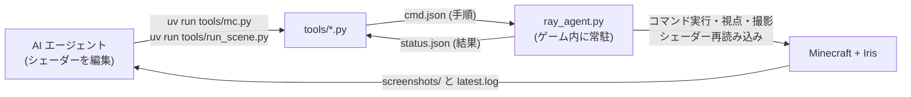
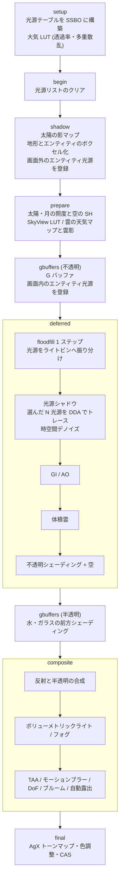

# Ray


Rayは元々私が欲しかった他のシェーダーにない機能を全て詰め込んだプライベートに作られた Minecraft Java Edition - Iris 向けのシェーダーパックです  
このシェーダーには、ボクセルレイトレースによる光源処理と実在レンズを再現するフィジカルレンズシミュレーションを搭載しています

日常利用よりも、リプレイMODやレンダリングMODを併用した撮影に向いていますが、設定を軽くすれば、普段のプレイで臨場感を高めることもできます  
このシェーダーは、外部のCGツールを挟まずシネマティックルックをゲーム内だけで完結させるのが目的です

現在はナチュラル寄りの見た目で制作しています

## 特徴

たいまつやランタンの光は、カメラ周辺のワールドをボクセルに変えてレイトレースし、遮るものの形どおりの影を落とします  
ブロックだけでなくプレイヤーやモブも光を遮るので、たいまつを持って歩くと自分やモブの影が壁に落ちます  
手に持った光源、地面に落としたたいまつ、燃えているモブ、光の矢や火の玉も同じように光源として扱います

水面の下の景色は屈折してゆがんで見えます  
水中の光芒が差し込み、光源のまわりのにじみは浅瀬でターコイズ、深い所で紺になります

ボケやブルームを足すだけではなく、ポストプロセスでフィジカルレンズシミュレーションを行い、実在するレンズの写りを再現します  
Helios 44-2 や Sonnar のようなオールドレンズから、Hologon や Flektogon の超広角、魚眼までプリセットで選べます  
プリセットのうち 12 本は、特許に載った実施例の処方から計算しています  
ゴーストの色と形、歪曲、周辺減光、ボケの形、色収差はレンズごとに変わります

> [!WARNING]
> 現在はまだアルファ版です
> 見た目と負荷はまだ調整中で、設定項目や既定値は予告なく変わる可能性があります

<!-- スクショ予定 -->

## 動作環境

| 項目 | 要件 |
|---|---|
| Minecraft | Java Edition 1.21.x - 26.x |
| シェーダーローダー | Iris 1.8 以降 (Sodium と併用) |
| OpenGL | 4.6 (シェーダーは GLSL 4.60 で、compute shader / SSBO / カスタムイメージを使います) |
| OS | 開発と動作確認は Windows のみです。macOS は compute shader が使えないため動きません |
| GPU | 必要な性能はまだ測れていません |

> [!IMPORTANT]
> OptiFine では動きません。SSBO・カスタムイメージ・`shadow_entities` など Iris にしかない機能を前提にしています

> [!NOTE]
> 現状はまだ Distant Horizons には対応していません (`dh_*` プログラムを持っていません)。入れたままでも Iris は DH 用のシェーダーがないパックとして扱いますが、LOD 部分の見た目は保証できません

## 導入

リポジトリの中にある `shaders/` フォルダがシェーダーパックの本体です。配布用の zip はまだ用意していないので、次の手順で入れてください

1. リポジトリを clone するか、ZIP でダウンロードして展開します
2. `shaders/` を直接含むフォルダを `<Minecraft のインスタンス>\shaderpacks\` に置きます
3. ゲーム内の ビデオ設定 -> シェーダーパック で Ray を選びます

zip にして置く場合は、`shaders/` が zip の直下に来るように作ります

## 機能

### 光源と影

| 機能 | 内容 |
|---|---|
| 光源シャドウ | カメラ周辺のワールドをボクセルに変換し、ピクセルごとに寄与の大きい光源を選んで DDA でレイを飛ばします。ハーフブロックは形どおりに光を遮り (階段はハーフブロックとして近似します)、色付きガラスを通った光には色が付きます |
| エンティティによる遮蔽 | プレイヤー・モブ・ブロックエンティティのモデルの三角形をそのまま使い、体の形どおりの影を落とします。スケルトンの肋骨のような透明な部分は光を通します。三角形が多すぎて収まらない分と「低」の設定では、0.5 ブロック単位のボクセルで近似します |
| 手持ち光源 | 両手をそれぞれ独立した光源として扱います。壁にはボクセルのレイ、手や武器・近くのモブにはスクリーンスペースのレイで影を付けます。陰の暗さは「手持ち光源の陰の濃さ」で変えられます |
| ドロップ・投擲物・燃焼・発光エンティティ | 落としたたいまつ、光の矢や火の玉、燃えているモブ、ブレイズやヒカリイカなどを光源として登録し、設置した光源と同じ方法で影を付けます |
| 色付き floodfill | 光源の色をボクセルの中で広げて間接光にします。光源シャドウを切ったときはこれだけで照らします。壁で跳ね返った光には壁の平均の色が混ざります (赤い壁のそばは赤みを帯びる)。濃さは「ブロックライトの壁の照り返し」で変えられます |

### 空・マテリアル・カメラ

| 機能 | 内容 |
|---|---|
| 大気 | Hillaire (2020) 方式の LUT で空を描きます。太陽・月の照度と空の環境光は全パスで共有します |
| 雲 | 天気図で雲の種類と量が決まる 3 層の雲です。低層 (積雲・層積雲・乱層雲・積乱雲) と中層 (高積雲・高層雲) は体積雲、上層 (巻雲・巻積雲・巻層雲) は平面で描きます。雲の形は Ray / Bliss 風 / バニラの形 / 現実に忠実 / 綿あめ / 入道雲 / まばらな晴天積雲 / 層積雲の曇りから選べます。軽い 2D の雲と雲の影もあります |
| フォグ | 上面の平らなもや・中くらいの高さの霧の層・谷霧 (時間帯・日替わり・天気・バイオームで変わる)、遠景が同じ方位の地平線の空へ溶ける空中遠近、スタイル (Ray / Bliss 風 / Nostalgia 風 / カスタム) とワールドの高さに合わせたテンプレート、ボリューメトリックライト (影の距離より遠くの光芒も)、太陽や月から放射状にぼかす画面空間の光芒、ブロックライトに照らされるフォグ、洞窟への光漏れ防止 |
| 太陽の影 | PCSS、色付きの影、スクリーンスペースの接触影、葉を通る光 (木漏れ日や森の床が葉の色に染まり、葉が重なるほど暗くなります) |
| GI / AO | RSM / SSGI / ボクセルレイトレースの GI (プリセットで切り替え)、GTAO / SSAO |
| マテリアル | labPBR、法線マップ、テクスチャからの法線生成、POM、表面下散乱、雨の水たまり |
| 水と反射 | 波と視差、屈折 (スクリーンスペース / レイトレース)、コースティクス、SSR とラフ反射、ボクセルによる反射の補完、水中の光芒と光源の周りの光のにじみ (浅瀬はターコイズ、深い所は紺) |
| カメラ | AgX (既定) を含む 6 種のトーンマップ、ヒストグラムによる自動露出 (明るくなるときと暗くなるときで順応の速さが違います)、MIP-Bokeh の被写界深度とオートフォーカス、TAA、モーションブラー、ブルーム、レンズフレア、カラーグレーディング (シャドー・ミッド・ハイライト、リフト・ガンマ・ゲイン、色相ごとの調整、トーンカーブ、スプリットトーン、ASC CDL)、暗所の青みがかり、フィルムグレイン |

各機能の手法と出典は [docs/architecture.md](docs/architecture.md) と [CREDITS.md](CREDITS.md) にあります

## ルック

設定画面のトップの「ルック」で、光と色の作り方をまとめて選べます。その下の「LUT」で、最後に色の LUT を重ねられます

| 番号 | ルック | 見た目 |
|---|---|---|
| 0 | カスタム | プリセットにしか無い値を「ポストプロセス」の「カスタムルック」で決めます (既定値はナチュラルと同じ) |
| 1 | ナチュラル (既定) | 素朴なマイクラらしさを残した、目の疲れない見た目です |
| 2 | ビビッド | SEUS Renewed / PTGI のような、見ているだけできれいな見た目です。全体の彩度を上げるのではなく、日向の暖色と日陰の青緑の色の割れ、草の照り返しで緑がかる日陰・白樺の幹・洞窟の入り口、白近くまで伸びる明るい所で見せます。目が疲れないよう、日陰は SEUS ほど暗くせず、ブルームとコントラストは控えめです |
| 3 | デイライト | ビビッドの光に、濃い青空・緑の草・日向の凹凸の陰影を足した、晴れた日中のパンチのある見た目です |
| 4 | 夏の青空 | 明るく軽い真夏の日中です。地平線の近くまで濃い青空、瑞々しい緑、暖かい日差し |
| 5 | ゴールデンアワー | 一日中が夕方前の低い日差しのような暖かさと、柔らかいブルームです |
| 6 | ティール & オレンジ | 映画の定番です。暗い側と草を青緑、明るい側と木・土を橙に寄せます |
| 7 | ブリーチバイパス | 色の抜けた硬い絵です。コントラストが強いので、長く遊ぶと目が疲れやすくなります |
| 8 | クロスプロセス | 黄緑に転んだ明るい所と青い暗い所です。色とコントラストが強めです |
| 9 | ゲーム (鮮やか) | 色をはっきり出し、暗い所も見やすくした鮮やかな見た目です |

3 以降のプリセットは、光の値 (下の表) に加えて、色と階調の多くをカラーグレーディング (下の「カラーグレーディング」) の基準として持ちます。値は `shaders/lib/common/look_presets.glsl` にあります

ナチュラルとビビッドが決める値は次のとおりです。「掛ける」の値は、既存の設定 (彩度・コントラスト・ブルーム・ブルーミーフォグ・空の光の遮蔽・空の環境光の彩度・フォグの濃さ) にさらに掛かります。露出補正は足されます。ナチュラルは明部の伸びだけが 1.1 で、ほかは掛ける値が 1、足す値が 0 なので、各設定の値がそのまま効きます

| 値 | ナチュラル | ビビッド | 内容 |
|---|---|---|---|
| 空の環境光の強さ | 1 | 0.8 | 日陰を照らす空の光。空そのものの明るさは変えません |
| 空の環境光の彩度 (掛ける) | 1 | 1.1 | 日陰の空の光の青み |
| 空の色の彩度 | 1 | 1.08 | 空の青の濃さ |
| 日向の暖かさ | 0 | 0.85 | 太陽の直達光だけを暖色に寄せます (1 で 6500K に対して 5000K の色) |
| 照り返しの強さ | 1 | 1.6 | GI のレイが当たった面からの光だけを強めます (空の光は変えません) |
| 照り返しの色の濃さ | 1 | 1.5 | 草の照り返しの緑など。明るさは変えません |
| 空の光の遮蔽 (掛ける) | 1 | 1.6 | SSGI / ボクセルレイトレースの時だけ。既定の 0.5 に掛けて 0.8。洞窟の中や軒下に、向きの無い空の青が回り込みにくくなります |
| 露出 (足す) | 0 | -0.15 EV | |
| 明部の伸び | 1.1 | 1.6 | 中間グレーより明るい所の明るさの差を広げます (暗い所は変えません) |
| 暗部の持ち上げ | 0 | 0.5 | 2.2 乗で表示するモニターで、トーンマップの暗部が黒くつぶれる分を戻します |
| コントラスト / 彩度 (掛ける) | 1 / 1 | 1 / 1.1 | |
| ブルームの強さ (掛ける) / 広がり | 1 / 0.82 | 1.2 / 0.75 | 広がりを狭めて、光のまわりに締まった滲みにします |
| 晴れのブルーミーフォグ | 0.35 | 0.35 | 晴れの日に遠景に掛かる広い滲みの割合 (雨では 1) |
| フォグの濃さ (掛ける) | 1 | 1.15 | 遠景の空気遠近 |

- ルックは品質プリセット (低〜極限) とは別に選べ、品質プリセットを変えても変わりません
- GI の方式 (RSM / SSGI / ボクセルレイトレース) で照り返しの出方が違います。RSM (「高」) は照り返しの色が濃く出るので、照り返しの色の濃さは半分だけ掛けます

### LUT

| 番号 | LUT |
|---|---|
| 0 | なし (既定) |
| 1 | ユーザーの LUT (`shaders/textures/look/user_lut.png`) |
| 2 | 日向と日陰の色の割れ: 日向を暖色、日陰を青緑に寄せ、明るい緑を黄緑へ、空の青を少し深くします |
| 3 | フィルム: コントラストを少し下げ、明るい所を暖色に寄せて彩度を落とします |
| 4 | Portra 風: 低めのコントラスト、少し浮いた黒、控えめで暖かい色、オリーブ寄りの緑 |
| 5 | Ektar 風: 鮮やかな赤と青、締まったコントラスト |
| 6 | Vision3 500T 風: タングステン用の映画フィルムを昼に使ったような青み、柔らかい階調、青緑の暗部 |
| 7 | Velvia 風: 高い彩度とコントラスト、濃い青空と緑。色とコントラストが強めです |
| 8 | Provia 風: 素直で少し鮮やか、少し冷たく澄んだ白 |
| 9 | Eterna 風: 落ち着いた低い彩度と柔らかいコントラスト、青緑に寄った暗部 |

LUT はトーンマップの後の表示の色 (sRGB) に掛かります。「LUT の強さ」で元の色と混ぜられます

フィルム風の LUT (4-9) は、各社が公開している技術資料の特性の説明 (コントラスト・彩度・色の傾向・色温度) から `tools/gen_look_lut.py` で作った近似です。メーカーの LUT やデータは使っていません

自分の LUT を使うには、`shaders/textures/look/user_lut.png` を置き換えて「LUT」を「ユーザーの LUT」にします。同梱の `user_lut.png` は何も変えない恒等の LUT です

- 画像編集ソフトで作る: `user_lut.png` (1024x32) を開き、色調補正 (トーンカーブ・色相・彩度など。ぼかしや変形はしない) を掛けて同じ名前で保存します。ゲームの撮影に同じ補正を掛けたときと同じ色になります
- `.cube` (DaVinci Resolve・Photoshop などの 3D LUT) から作る: `uv run tools/gen_look_lut.py from-cube my.cube --out shaders/textures/look/user_lut.png`。入力は sRGB の表示値 (0-1) の LUT を想定しています
- 画像の形式: 32x32x32 の LUT を、青の段ごとに 32x32 の板を横に 32 枚並べた 1024x32 の PNG です。各板の x が赤、y が緑 (上の行が緑 0)
- 撮影した画面に LUT を試す: `uv run tools/gen_look_lut.py preview --lut my.cube --in shot.png --out out.png`

### カラーグレーディング

「ポストプロセス」の「カラーグレーディング」で、DaVinci Resolve のカラーページのような調整ができます。既定値ではどれも何もせず、ルックのプリセットの上に重なって効きます (彩度は掛け算、色や明るさのずれは足し算)

| 画面 | 内容 | 掛ける所 |
|---|---|---|
| 基本 | ホワイトバランス (色温度)、ティント (緑-マゼンタ)、コントラストとピボット、彩度とバイブランス、赤・緑・青のオフセット (チャンネルごとの露出)、ハイライトの圧縮、シャドーの持ち上げ | トーンマップ前 |
| シャドー・ミッド・ハイライト | 明るさの範囲ごとの赤・緑・青・輝度・彩度・コントラスト。範囲の境目 (中間グレーからの EV) と境目の柔らかさ | トーンマップ前 |
| 色相ごと | 赤・橙・黄・緑・水色・青・紫・マゼンタの色相・彩度・明るさ (間の色は補間し、色の薄い所には効きません) | トーンマップ前 |
| リフト・ガンマ・ゲイン | 赤・緑・青・輝度ごとのカラーホイール。リフトは黒、ゲインは白、ガンマは中間を動かします | トーンマップ後 |
| トーンカーブ | 0・10・25・50・75・90・100% の 7 点を通る単調な曲線。RGB 全部か輝度だけに掛けます | トーンマップ後 |
| スプリットトーン | シャドーとハイライトに別の色を足します (明るさは変わりません) | トーンマップ後 |
| CDL | ASC CDL (スロープ・オフセット・パワー・彩度)。他のソフトの値をそのまま入れる最後の調整 | LUT の後 |

掛ける順番は、ホワイトバランス -> ティント -> オフセット -> コントラスト -> シャドー・ミッド・ハイライト -> ハイライトの圧縮・シャドーの持ち上げ -> 彩度・バイブランス -> 色相ごと -> トーンマップ -> リフト・ガンマ・ゲイン -> トーンカーブ -> スプリットトーン -> LUT -> CDL です

- トーンマップ前の調整は、露出の段 (EV) の上で効きます。昼・夜・洞窟で明るさが変わっても同じように効き、トーンマップがはみ出しを畳むので色がクリップしにくくなります
- トーンマップ後の調整は、黒 0・白 1 の表示の値に掛かります。フィルム風の LUT はグレーディングの後に掛かるので、LUT の色の下でグレードを調整できます
- 「グレーディング」を切ると、この画面の調整とルックのプリセットのグレーディングをまとめて外せます (ホワイトバランス・コントラスト・彩度・LUT・CDL は残ります)
- 描画の重さはほとんど変わりません (最後のパスで計算するだけで、追加のテクスチャを使いません)

## レンズ

設定画面の「レンズ」で、実在のレンズの写りを選べます  
レンズごとに、フレアのゴーストの色と形、光条の本数、ボケの形、にじみ、周辺の暗さ、歪曲が変わります。「カスタム」を選ぶと、各効果の強さを「カスタムレンズ」の画面で個別に決められます

7〜18 の 12 本は、特許に載った実施例の処方 (面の曲率半径・間隔・ガラスの屈折率と分散) を光線追跡して、ゴーストの位置と色、歪曲、周辺光量、像面湾曲と非点収差によるボケ、色収差を計算しています  
処方から焦点距離を計算し直すと、どれも公称値と 1% 程度以内で一致します。コーティングと絞り羽根は処方に無いので、製品の資料と作例から決めています

「適した FOV」は、35mm 判の横幅 36mm を画面の横幅に合わせたときの実物の画角を、Minecraft の FOV (縦の画角) に直した値です。画面は 16:9 なので、35mm 判 (3:2) の上下が切れた構図になります。焦点距離 f (mm) のレンズでは 縦の FOV = 2 atan(18 / f x 9 / 16) で、35mm は 32、20mm は 54、15mm は 68 です
50mm 以上はゲームの FOV の下限 (30) より狭くなるので 30 にしています (実物より少し広い画角)

| 番号 | レンズ | 年代 | 構成 | 描写の特徴 | 適した FOV |
|---|---|---|---|---|---|
| 0 | カスタム | - | 構成 (ゴーストの設計) は下の 15 種から選べる | 各効果の強さを個別に指定。歪曲の 4 次の項 (陣笠型)、魚眼の写像、ボケの縁を溶かすアポダイゼーションも選べる | - |
| 1 | 現代の大口径単焦点 (50mm F1.8 級) | 現代 | マルチコート、9 枚羽根 | 収差はほぼ補正済みで控えめ。既定 | 30 (どれでも) |
| 2 | Helios 44-2 58mm F2 | 1958 年〜 (Helios-44 系) | 4 群 6 枚の Biotar 型、単層コート、8 枚羽根 | ぐるぐるボケと猫目ボケ、開放の柔らかさ | 30 |
| 3 | Super Takumar 50mm F1.4 | 1965 年 | 6 群 7 枚、単層コート、6 枚羽根 | 開放の強いにじみと色収差、トリウムガラスの黄変 (暖色寄り) | 30 |
| 4 | Petzval 85mm F2.2 相当 | 1840 年の設計 | 2 群 4 枚、円形絞り | 強い像面湾曲で周辺が渦を巻いて溶ける。周辺減光も強い | 30 |
| 5 | Canon FD 50mm F1.4 S.S.C. | 1973 年 | 6 群 7 枚、多層コート、8 枚羽根 | フレアが少なく、開放でわずかににじむ癖の弱いオールドレンズ | 30 |
| 6 | アナモルフィック | シネマ用 | 2 倍の前玉アナモルフィック相当の見た目 | 青い横ストリーク、縦長の楕円ボケ、樽型歪曲 | どれでも (焦点距離を決めていない) |
| 7 | Zeiss Sonnar 50mm F1.5 (Contax) | 1932 年 | 3 群 7 枚 (貼り合わせ)、戦後型の単層コートと 11 枚羽根 | 空気との境界が 6 面だけでゴーストが少なく、コントラストが高い。四隅がわずかに外へ引っ張られる糸巻き型の歪曲 (隅で 3%)。後ボケは柔らかい | 30 |
| 8 | Leica Summilux 35mm F1.4 (初代) | 1961 年 | 5 群 7 枚、単層コート、10 枚羽根 | 開放で光がにじむ「Leica glow」。歪曲はほぼ無い。四隅は大きく暗く、周辺の玉ボケはレモン形 (猫目) | 32 |
| 9 | Canon 50mm F1.2 (L39) | 1956 年 | 5 群 7 枚、単層コート、11 枚の内側に反った羽根 | 開放は柔らかく低コントラスト。周辺は非点収差で背景が流れ、四隅は開放で約 -3.4 EV 落ちる。太陽を入れるとゴーストが多く、色収差も強め | 30 |
| 10 | Zeiss Hologon 15mm F8 (超広角) | 1970 年頃 | 3 群 3 枚、羽根の無い固定 F8 | 対角 110° でも直線がまっすぐ (歪曲がほぼ 0)。四隅に向かって大きく暗くなる (隅で約 -2.5 EV)。ほぼ全てにピントが合う | 68 |
| 11 | Carl Zeiss Jena Flektogon 20mm F4 (超広角) | 1963 年 | 6 群 10 枚のレトロフォーカス、単層コート | 画面の中ほどで樽型、四隅で糸巻き型に戻る「陣笠型」の歪曲 (2% ほどで控えめ)。四隅は設計の画角の外でボケが流れる | 54 |
| 12 | Minolta Fish-eye Rokkor 16mm F2.8 (魚眼) | 1969 年〜 | 7 群 10 枚 + 内蔵フィルター、対角 180° | 画面の中心を通らない直線が大きく曲がり、端の物が引き伸ばされずに丸く写る。周辺はあまり暗くならない | 110 |
| 13 | Nikon Gyogyotto 20mm F8 (魚眼) | 1995 年 | 2 群 3 枚、F8 固定 (絞り羽根なし)、対角 153° | 正射影に近い写り方の魚眼で、画面の端ほど強く押し縮められ、ガラス玉を覗き込んだように丸く写る。Rokkor より中心が大きく、端の曲がりが強い。ほぼ全てにピントが合う | 107 |
| 14 | Voigtländer Ultra Wide-Heliar 12mm F5.6 (超広角) | 2000 年 | 8 群 10 枚 (非球面 1 枚)、対角 121° | 発売時に最も広かった直線写像のレンズ。直線はほぼまっすぐ (ゆるい樽型、隅で 2%) のまま、四隅は絞っても大きく暗い (約 -3 EV) | 80 |
| 15 | Canon New FD 14mm F2.8L (超広角) | 1982 年 | 10 群 14 枚 (研削非球面 1 枚)、6 枚羽根、対角 114° | 画面の中ほどで膨らみ四隅で弱まる樽型の歪曲 (約 3%)。開放の四隅は大きく暗く (約 -3 EV)、2 段絞ると明るくなる | 72 |
| 16 | Minolta STF 135mm F2.8 [T4.5] | 1999 年 | 6 群 8 枚 + アポダイゼーションフィルター、10 枚の円形絞り | 周辺ほど暗くなるフィルターで、ボケの縁が輪郭を残さずに溶けて消える。歪曲や周辺減光はほぼ無く、ボケの形だけが変わる | 30 |
| 17 | Pentax FA 28mm F2.8 Soft | 1997 年 | 5 群 5 枚、多層コート、6 枚羽根 | 広角のソフトフォーカス。開放ではピントの合った所にも大きな光のにじみが付き、F4 で弱まり、F5.6 でシャープになる。周辺ほど柔らかい | 40 |
| 18 | Canon 50mm F0.95 | 1961 年 | 5 群 7 枚のガウス型、10 枚羽根 | 「Dream Lens」。開放の四隅が極端に暗く (約 -4 EV、2 段絞ると -2 EV)、開放でにじむ。隅は色ずれが強く、樽型の歪曲がある | 30 |

- レンズを足すときは後ろに足し、既存の番号は変えません (保存した設定が別のレンズを指さないように)
- 50mm 以上のレンズは FOV 30 でも実物より画角が広いので、どの FOV でも「そのレンズの写りの味付け」として掛かります。収差の強さは画面の隅を 35mm 判の隅に合わせて決めているので、FOV を変えても見た目の形は同じです (魚眼の写り方だけは角度で計算するので FOV で変わります)
- 超広角と魚眼は、表の FOV で使うと実物の画角に近くなります。ゲームの描画は直線写像なので、歪曲と魚眼の写り方は最後の段で画面を再投影して作ります。被写界深度・ブルーム・TAA は再投影の前の画面で計算し、太陽のフレアは再投影の後の画面で光源の位置に合わせて描きます
- 魚眼は、中心が 2 倍ほど引き伸ばされるので少し柔らかくなります。既定は画面の隅まで埋める合わせ方で、「魚眼の合わせ方」を「横幅を合わせる」にすると、実物に近い画角になる代わりに描画の範囲外になる四隅が黒くなります。実物の対角 180° はゲームが描ける範囲 (FOV 110 で対角 142°) を超えるので、魚眼の FOV は上限の 110 にしています。このとき「横幅を合わせる」の横の画角は 137° で、実物 (140°) とほぼ同じです
- 魚眼と歪曲の強い設定では、歪曲を TAA の中で組み立てます (「歪曲を TAA で組み立てる」、既定は自動)。ジッターで毎フレーム少しずつずれた画面から出力の画面を作るので、止まっている時やゆっくり動く時は、引き伸ばされた魚眼の中央も細かく写ります。速く動く時と TAA を切っている時は、最後の段で引き伸ばす方式と同じ写りです
- Gyogyotto は「魚眼の合わせ方」が「隅まで埋める」(既定) のとき FOV 107 で実物の 20mm になり (110 でもほぼ同じ)、Rokkor と違って実物の焦点距離のまま四隅まで描けます
- STF 135mm のアポダイゼーションは、被写界深度のボケの各点に、絞りの上の位置に応じた透過率 (中心ほど明るく縁ほど暗い) を掛けて作ります。製品の T 値 (開放 T4.5、F5.7 で T6.7) に合う透過率にしてあり、絞ると絞りの外側が切れて普通の円いボケに近づきます
- FA 28mm Soft の柔らかさは、処方から計算したピントの合った点の広がり (ハローの大きさと、芯の外に行く光の割合) を F 値ごとに持って、ブルームの縮小画像から作ります。開放で最も強く、F5.6 で消えます。F 値は被写界深度の「絞りの決め方」を「F 値を指定」にして変えます (「ボケの量」のままだと開放の F2.8)。Canon 50/0.95 のにじみも同じ仕組みで、開放だけに掛かります
- 補正不足の球面収差のレンズ (FA 28 Soft など) は、後ボケが中心の明るいにじんだ円、前ボケが縁の明るい輪になります (前と後で逆)
- 「歪曲収差の強さ」を上げると、処方どおりでは控えめな歪曲 (Flektogon の陣笠型など) を誇張できます。「歪曲収差」を OFF にすると、魚眼も含めてゲームの直線写像のままになります

## 品質プリセット

設定画面の一番上で、品質プリセットを 9 段階から選べます。並びは軽い順で、既定は「高」です。プリセットを選んだあとに個別の項目を変えても構いません

- 高 (最軽量) / 高 (軽量): 高と同じ手法と見た目のまま、内部の解像度 (光源のトレース・ボリューメトリックライト、最軽量では雲も) とサンプル数 (影のぼかし・GI・光源・反射) を下げ、時間方向の積み重ねとデノイズで補います
- 極限 (軽量): 極限の手法 (ボクセルレイトレースの GI・ボクセル補完の反射など) のまま、範囲と解像度を最高にそろえます
- 極限 (バランス): 極限の範囲のまま、光源のトレース・GI・雲・ボリューメトリックライトを半分の解像度にします
- 雲の形と陰影は中以上のどのプリセットでも同じです。変わるのは細かいノイズの量と重さだけです

| 項目 | 低 | 中 | 高 (最軽量) | 高 (軽量) | 高 (既定) | 最高 | 極限 (軽量) | 極限 (バランス) | 極限 |
|---|---|---|---|---|---|---|---|---|---|
| 重さの目安 (高 = 1.0) | - | 0.55 | 0.83 | 0.94 | 1.00 | 0.99 | 1.02 | 1.57 | 2.48 |
| ボクセル範囲 (ブロック) | 128x64x128 | 192x96x192 | 256x128x256 | 256x128x256 | 256x128x256 | 256x128x256 | 256x128x256 | 384x128x384 | 384x128x384 |
| 光源シャドウ | OFF | ON | ON | ON | ON | ON | ON | ON | ON |
| 1 ピクセルあたりの光源数 | - | 2 | 2 | 4 | 4 | 8 | 8 | 16 | 16 |
| 光源トレースの解像度 | - | 1/2 | 1/4 | 1/4 | 1/2 | フル | 1/2 | 1/2 | フル |
| エンティティ / プレイヤーによる遮蔽 | OFF / OFF | OFF / ON | ON / ON | ON / ON | ON / ON | ON / ON | ON / ON | ON / ON | ON / ON |
| 手持ち光源のレイと接触影 | OFF | ON | ON | ON | ON | ON | ON | ON | ON |
| エンティティ光源 (ドロップなど) | OFF | ON | ON | ON | ON | ON | ON | ON | ON |
| 太陽の影 (解像度 / 距離) | 1024 / 96 | 2048 / 128 | 4096 / 192 | 4096 / 192 | 4096 / 192 | 4096 / 256 | 4096 / 256 | 8192 / 512 | 8192 / 512 |
| 影のフィルタ (サンプル数) | PCF (4) | PCF (8) | PCSS (8) | PCSS (12) | PCSS (16) | PCSS (24) | PCSS (24) | PCSS (32) | PCSS (32) |
| AO | なし | SSAO | GTAO | GTAO | GTAO | GTAO | GTAO | GTAO | GTAO |
| GI (解像度, サンプル数) | なし | なし | RSM (1/2, 1) | RSM (1/2, 1) | RSM (1/2, 2) | SSGI (1/2, 4) | ボクセル RT (1/2, 4) | ボクセル RT (1/2, 4) | ボクセル RT (フル, 8) |
| 反射 (SSR の歩数) | 空のみ | SSR (12) | SSR + ラフ反射 (16) | SSR + ラフ反射 (24) | SSR + ラフ反射 (24) | SSR + ラフ反射 (32) | SSR + ボクセル補完 (32) | SSR + ボクセル補完 (48) | SSR + ボクセル補完 (48) |
| 水の屈折 / コースティクス | なし / OFF | SS / OFF | SS / OFF | SS / OFF | SS / OFF | レイトレース / ON | レイトレース / ON | レイトレース / ON | レイトレース / ON |
| POM | OFF | OFF | OFF | OFF | OFF | ON | ON | ON | ON |
| 大気 | 解析近似 | 解析近似 | LUT | LUT | LUT | LUT | LUT | LUT | LUT |
| 体積雲 (解像度 / 歩数) | なし | 1/4 / 低 | 1/4 / 中 | 1/2 / 中 | 1/2 / 中 | 1/2 / 高 | 1/2 / 高 | 1/2 / 最高 | フル / 最高 |
| ボリューメトリックライト (解像度) | OFF | ON (1/4) | ON (1/4) | ON (1/4) | ON (1/2) | ON (色付き, 1/2) | ON (色付き, 1/2) | ON (色付き, 1/2) | ON (色付き, フル) |
| 被写界深度 (サンプル数) | OFF | ON (30) | ON (30) | ON (30) | ON (30) | ON (50) | ON (50) | ON (75) | ON (75) |
| モーションブラー | OFF | OFF | ON | ON | ON | ON | ON | ON | ON |
| ブルーム / レンズフレア | OFF / ON | ON / ON | ON / ON | ON / ON | ON / ON | ON / ON | ON / ON | ON / ON | ON / ON |
| 自動露出 | 平均 | 平均 | ヒストグラム | ヒストグラム | ヒストグラム | ヒストグラム | ヒストグラム | ヒストグラム | ヒストグラム |

自動露出は、屋外の夜を月の満ち欠けと天気で変えます。月が照らす晴れた夜は暗い所に合わせて強めに持ち上げ、新月・雨の夜・水中は持ち上げを弱くして暗さを残します。「平均」の露出は暗い所の計測を使わず、持ち上げの傾きと上限だけ月の満ち欠けで変わります。マニュアル露出には掛かりません

重さの目安は、RTX 2080 Ti・1297x803 で 4 つの場面 (晴れの正午の屋外・森・洞窟のたいまつ・夕方の水辺) のフレーム時間を平均し、「高」を 1.0 にした比です。高・最高・極限 (軽量) の差は測定のばらつきと同じくらいです。「低」は測っていません

<details>
<summary>詳しい設定の値 (プリセット別)</summary>

主な設定項目とプリセットごとの値は [docs/architecture.md の「設定とプリセット」](docs/architecture.md#設定とプリセット) にまとめています

既定値は [`shaders/lib/settings/`](shaders/lib/settings) (「高」と同じ値) に、プリセットは [`shaders/shaders.properties`](shaders/shaders.properties) の `profile.*` に定義しています

</details>

### 重い機能の個別 ON/OFF

光源まわりの重い機能は、プリセットとは別に個別で切り替えられます。どれも設定画面の「ブロックライト」の中にあります

| 設定 (画面の表示名) | 場所 | 内容 | OFF になるプリセット |
|---|---|---|---|
| 光源シャドウ | 光源シャドウ | 設置した光源のレイトレース影。OFF にすると色付き floodfill だけで照らします | 低 |
| 1 ピクセルあたりの光源数 / トレース解像度 | 光源シャドウ | 影を付ける光源の数と、トレースする解像度 (1 / 1/2 / 1/4) | - |
| エンティティによる遮蔽 | 光源シャドウ | モブ・ブロックエンティティが光を遮ります | 低, 中 |
| プレイヤーによる遮蔽 | 光源シャドウ | プレイヤーが光を遮ります | 低 |
| 光源の接触影 | 光源シャドウ | ボクセルに収まらない細部をスクリーンスペースで補います | 低, 中 |
| 手持ち光源のレイ | 手持ち光源 | 手持ち光源のボクセルレイ影 | 低 |
| 手持ち光源の接触影 | 手持ち光源 | 手持ち光源のスクリーンスペース影 | 低 |
| エンティティ光源 | エンティティ光源 | 下の 4 つをまとめて切るスイッチ | 低 |
| ドロップした光源アイテム / 投擲物の光 / 燃えるエンティティの光 / 発光エンティティの光 | エンティティ光源 | 種類ごとのスイッチ | - |

> [!TIP]
> 光源シャドウ、GI と AO (両方 OFF のとき)、体積雲、大気 LUT、反射、ボリューメトリックライト、TAA、モーションブラー、被写界深度、ブルームは、OFF にすると対応するパスごと実行されなくなります (`shaders.properties` の `program.*.enabled`)。重いときはこれらから切ってみてください

## 開発

### リポジトリ構成

| パス | 内容 |
|---|---|
| [`shaders/`](shaders/) | シェーダーパック本体。処理は `lib/` と `program/` にあり、`world0` / `world-1` / `world1` は include だけのラッパーです |
| [`docs/`](docs/) | 設計資料 ([`docs/README.md`](docs/README.md) が目次) |
| [`pyproject.toml`](pyproject.toml) | tools 用の Python 環境の定義 (uv) |
| [`AGENTS.md`](AGENTS.md) | コーディングエージェント向けの作業メモ (構成・検証コマンド・規約) |
| [`tools/`](tools/) | テクスチャ生成、コンパイル検証、ゲーム内デバッグ用の Python スクリプト ([`tools/README.md`](tools/README.md)) |

### ジャンクションでつなぐ

開発中は `shaderpacks\` にコピーせず、ジャンクションでリポジトリにつなぐと編集がそのまま反映されます。ゲーム内で `R` キーを押すとシェーダーが再読み込みされます

```powershell
New-Item -ItemType Junction -Path "<Minecraft のインスタンス>\shaderpacks\Ray" -Target "<このリポジトリのパス>"
```

`cmd` なら `mklink /J "<インスタンス>\shaderpacks\Ray" "<リポジトリ>"` です。ジャンクションは管理者権限なしで作れます

### コンパイルの検証

ゲームを起動せずにコンパイルエラーを調べられます。スクリプトの Python 環境は [uv](https://docs.astral.sh/uv/) で管理しているので、最初にリポジトリ直下で `uv sync` を実行してください。glslang の入手方法やオプションは [tools/README.md](tools/README.md) にあります

```powershell
uv sync                                   # 初回だけ。.venv/ に Python 3.11 と numpy・glfw・PyOpenGL が入ります
uv run tools/validate_shaders.py          # Iris の前処理を再現して glslang でコンパイル (既定値・オーバーワールド)
uv run tools/validate_shaders.py --full   # 既定値を 3 ディメンションで、全プロファイルをオーバーワールドで
uv run tools/gl_compile_check.py          # 手元の GPU ドライバで compile + link
```

### AI エージェントによる自動デバッグループ

[Minescript](https://minescript.net/) (Python スクリプトを動かすクライアント mod) を使い、ゲームの外から「設定変更 -> シェーダー再読み込み -> 定点シーンの撮影 -> ログ確認」を回せるようにしています  
コマンドはすべて CLI なので、コーディングエージェントにシェーダーを編集させ、撮影したスクリーンショットとログを見て直させる、というループをそのまま回せます



```powershell
$env:RAY_MC_DIR = "<ゲームディレクトリ>"
uv run tools/shader_options.py set GI_MODE=0 LIGHT_SHADOWS=false   # 設定を書き換える
uv run tools/run_scene.py --all --reload --tag v2                  # 再読み込みして全シーンを撮影 -> <game>/screenshots/v2_<シーン>.png
```

ゲーム側の準備 (Minescript の導入、`ray_agent.py` の常駐、定点シーン `scenes.json` の作り方) は [tools/README.md](tools/README.md#ゲーム内で撮影する) にあります

### はまりやすい点

> [!WARNING]
> - `*.properties` には ASCII 以外の文字を書かないでください。Iris は ISO-8859-1 で読むので、コメントでも日本語が入るとファイル全体が無視されます (`validate_shaders.py` が検査します)
> - NVIDIA のドライバでは image uniform が 1 ステージ 8 個までです。`lib/buffers/images.glsl` の宣言は opt-in なので、image に書くプログラムでは `common.glsl` を宣言する前に使う `IMG_*` だけを `#define` してください

## パイプライン

Iris の実行順に沿った処理の流れです。パスごとの入出力とバッファの割り当ては [docs/architecture.md の「レンダーパイプライン」](docs/architecture.md#レンダーパイプライン) にあります



<details>
<summary>ブロックライトの流れ (光源シャドウの仕組み)</summary>

1. ボクセル化: shadow パスで地形をボクセル (1 ブロック = 1 セル) に書き込みます。エンティティはモデルの三角形を SSBO に書き込み (収まらない分は 0.5 ブロック単位の占有ビット)、光るエンティティ (ドロップアイテムや燃えるモブなど) は光源として登録します
2. floodfill: 光源の色を 6 近傍へ 1 フレームに 1 ステップずつ広げ、間接光のもとにします
3. 光源の振り分け: すべての光源を 8x8x8 ブロックのライトビンに振り分けます
4. トレース: ピクセルごとに、所属するビンの光源を明るさで重み付けします。上位 N-1 個は必ずトレースし、残りからは 1 個を明るさに比例した確率で選んでトレースするので、選ばれなかった光源にも平均すると正しく影が付きます。半影は光源の大きさの範囲で時間方向に揺らして作ります
5. デノイズ: 再投影と近傍クランプ、エッジを保つ空間フィルタでノイズをならします
6. 合成: 直接光、floodfill (間接光)、手持ち光源、鏡面反射をまとめて照らします

手持ち光源は二重に足されないよう floodfill には入れず、ピクセルごとに直接計算します

</details>

## ロードマップ

- [ ] 公開・配布
  - [ ] プリセットごとに必要な GPU 性能を測る
  - [ ] Linux での動作確認
- [ ] 光源の問題
  - [ ] 光源が密集した場所のちらつきを抑える (ライトビン 1 つに 64 個までしか入らず、上位から漏れた光源は毎フレーム確率で選んでいるため。時間方向の再利用を入れる)
  - [ ] 半透明の面にも光源の影を付ける (いまは floodfill だけで照らすので暗め)
  - [ ] エンダーチェストなどブロックエンティティの光をボクセルの光源に登録する
  - [ ] ライトブロック (`minecraft:light`) の光レベルを正しく読む
  - [ ] 階段を向きどおりの形で遮る (いまはハーフブロックとして近似)
  - [ ] MOD の光るブロックに対応する
- [ ] 最適化
  - [ ] 光源の多い場面での光源トレースを軽くする
  - [ ] 体積雲とボリューメトリックライトを軽くする
  - [ ] 計測した結果からプリセットの割り当てを見直す
- [ ] カメラ・レンズ
  - [ ] レンズのプリセットを増やす
  - [ ] 広角 (高い FOV) ゆがみ実装
- [ ] Distant Horizons 対応

## 支援

Ray の開発を支援していただけると大変励みになります！

- [GitHub Sponsors](https://github.com/sponsors/kuwacom)
- [Ko-fi](https://ko-fi.com/kuwadev)

## クレジットとライセンス

他のシェーダーパックのコードは使っていません  
実装の参考にした論文・手法とシェーダーパックは [CREDITS.md](CREDITS.md) に載せています

ライセンスは [LICENSE](LICENSE) (Ray Shader License 1.0) です。要点は次のとおりです

- プレイ・配信・動画・スクショ・映像作品は、収益化の有無を問わず自由です
- modpack への同梱は、有料の modpack でも、modpack 自体に実質的な中身があり、内容を変えずクレジットと公式リンクを添えてなら自由です(直接 zip に入れても構いません)
- 改変版フォークを公開する場合は、フォーク元明記と、見た目または機能の差別化が必要です。改変版もこのライセンスを継承します(ただの丸コピのリネームはダメ)
- 無改変の再配布は自由です。作者と公式へのリンクを添えてください
- 本体及び改変版フォークの販売や課金、広告を通した配布はできません(有料 modpack への同梱は除く)

このライセンスは、このファイルを含む版にのみ適用されます
